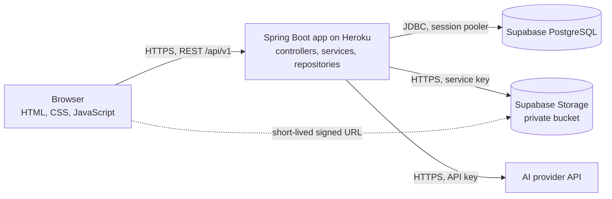

# Campus Companion

A Java-first student management and learning platform. It combines a student's academic records with study resources, practice tests and an AI study assistant in one web application.

> **Project status (2026-10-14): every P0 feature is built and tested; not deployed yet.** Students see their records, find and bookmark study material and past question papers, take timed practice tests, follow their progress and use the AI study assistant; administrators manage accounts, subjects, attendance, marks, results, timetables, notices, resources and the question bank. 220 unit tests and 209 integration tests pass. What is still open, mostly for the owner (AI provider, storage bucket, deployment), is in the [implementation plan](docs/16-implementation-plan.md#progress-on-2026-10-14) and the [security review](docs/21-security-review.md).
>
> Students log in with an institutional email address. A new student's first password is the roll number and must be changed at first login; that rule is a recorded security exception for demonstration with **synthetic data only** ([decision 0008](docs/decisions/0008-institutional-email-login.md)). The AI assistant runs on a built-in mock provider until a real one is chosen.

## The problem

Students check attendance, marks, timetables and notices in different places. Notes and previous-year papers are scattered across chat groups. There is no simple way to test yourself on a unit and see which topics are weak. A portal that only displays records gives students no reason to come back.

## What it does

| For students | For administrators |
| --- | --- |
| Dashboard, profile, attendance, marks, SGPA and CGPA | Manage student accounts, one at a time or from a CSV file |
| Timetable, notices and deadlines | Enter attendance, marks and results |
| Searchable notes and previous-year papers, with bookmarks | Manage subjects, units and timetables |
| Quick Exam: timed practice tests with instant scoring | Upload learning resources |
| AI study assistant: explain, summarize, generate questions | Maintain the question bank |
| Weak-topic tracking and revision recommendations | Publish notices; every change is written to an audit log |

## Technology

| Layer | Choice |
| --- | --- |
| Backend | Java 21, Spring Boot (Web, Security, Data JPA, Validation), Maven |
| Frontend | HTML, CSS and JavaScript, served by Spring Boot |
| Database | Supabase PostgreSQL through JDBC, migrations with Flyway |
| File storage | Supabase Storage, private bucket |
| AI | An external AI provider behind a Java interface; a mock provider until one is chosen |
| Tests | JUnit, Mockito, Spring Boot Test, Testcontainers (real PostgreSQL 17) |
| Hosting | Heroku |

There is no Node.js or Express backend. All application logic is Java.

## Architecture



Details are in [docs/05-architecture.md](docs/05-architecture.md).

## Getting started

**Prerequisites:** JDK 21, Git, and Docker (Colima works on a Mac) for the tests and for a local database.

1. Clone the repository.

   ```bash
   git clone https://github.com/Laxmansirvi05/student-management-system.git
   ```

2. Create your local configuration from the template and fill in the values. Never commit `.env`.

   ```bash
   cp .env.example .env
   ```

   For a throwaway local database instead of Supabase, start PostgreSQL in Docker with the two roles the application expects (their test passwords are in `init-roles.sql`), and point `DB_URL`, `DB_USERNAME`, `DB_PASSWORD`, `DB_MIGRATION_USERNAME` and `DB_MIGRATION_PASSWORD` at it:

   ```bash
   docker run -d --name cc-preview-db -e POSTGRES_PASSWORD=preview-only -p 127.0.0.1:54329:5432 -v "$PWD/src/test/resources/db/init-roles.sql:/docker-entrypoint-initdb.d/init.sql:ro" postgres:17-alpine
   ```

   Set `DEMO_SEED_ENABLED=true` for the first start to load invented students, subjects, records and practice questions. Set `ADMIN_BOOTSTRAP_EMAIL` and `ADMIN_BOOTSTRAP_PASSWORD` to create the first administrator.

3. Run the application with Java 21. Flyway applies the database migrations on startup, so make sure `DB_URL` points at the database you mean.

   ```bash
   export JAVA_HOME=$(/usr/libexec/java_home -v 21)
   ./mvnw spring-boot:run
   ```

4. Run every test. The integration tests start their own PostgreSQL in Docker.

   ```bash
   ./mvnw verify
   ```

5. Build the executable JAR, as Heroku does.

   ```bash
   ./mvnw -DskipTests package
   ```

Deployment is described in [docs/18-production-plan.md](docs/18-production-plan.md).

## Documentation

Status values: **Draft** (written, not yet reviewed by the owner), **Approved**, **Needs revision**.

| # | Document | Purpose | Status |
| --- | --- | --- | --- |
| 01 | [Project charter](docs/01-project-charter.md) | Vision, constraints, open decisions | Draft |
| 02 | [PRD](docs/02-PRD.md) | Functional requirements | Draft |
| 03 | [Scope and roadmap](docs/03-scope-and-roadmap.md) | What gets built, in what order | Draft |
| 04 | [TRD](docs/04-TRD.md) | Technical requirements | Draft |
| 05 | [Architecture](docs/05-architecture.md) | Components and flows | Draft |
| 06 | [App flow](docs/06-app-flow.md) | User journeys | Draft |
| 07 | [UI/UX spec](docs/07-ui-ux-spec.md) | Interface rules | Draft |
| 08 | [Database design](docs/08-database-design.md) | Schema | Draft |
| 09 | [API contract](docs/09-api-contract.md) and [openapi.yaml](docs/openapi.yaml) | REST API | Draft |
| 10 | [Authorization matrix](docs/10-authorization-matrix.md) | Who can do what | Draft |
| 11 | [Security plan](docs/11-security-plan.md) | Threats and controls | Draft |
| 12 | [AI features spec](docs/12-AI-features-spec.md) | What the AI assistant does | Draft |
| 13 | [AI rules](docs/13-AI-rules.md) | How the AI assistant behaves | Draft |
| 14 | [AI security and privacy](docs/14-AI-security-and-privacy.md) | Protecting users from AI risks | Draft |
| 15 | [AI features handoff](docs/15-AI-features-handoff.md) | AI implementation guide | Draft |
| 16 | [Implementation plan](docs/16-implementation-plan.md) | Ordered tasks | Draft |
| 17 | [Testing strategy](docs/17-testing-strategy.md) | How we prove it works | Draft |
| 18 | [Production plan](docs/18-production-plan.md) | Deployment | Draft |
| 19 | [Operations runbook](docs/19-operations-runbook.md) | What to do when it breaks | Draft |
| 20 | [Risk register](docs/20-risk-register.md) | Risks and mitigations | Draft |
| 21 | [Security review](docs/21-security-review.md) | Rule-by-rule review and open findings | Review of 2026-10-14 |
| 22 | [Loading real data](docs/22-loading-real-data.md) | What to do before and after loading the real students | Draft |
| 23 | [Deploying on Render](docs/23-deploying-on-render.md) | Free hosting steps with Supabase | Draft |
| | [Decision records](docs/decisions/README.md) | Why key choices were made | See index |
| | [Demo and viva guide](docs/demo-and-viva-guide.md) | Presentation preparation | Draft |

Rules for everyone working in this repository:

- [AGENTS.md](AGENTS.md): how coding agents work here.
- [SECURITY_RULES.md](SECURITY_RULES.md): mandatory application security rules.
- [AI_AGENT_SECURITY_RULES.md](AI_AGENT_SECURITY_RULES.md): what a coding agent may and may not do.
- [CONTRIBUTING.md](CONTRIBUTING.md): the single-branch workflow, commits, reviews.

Work is tracked in [GitHub Issues](https://github.com/Laxmansirvi05/student-management-system/issues). Do not report security vulnerabilities in a public issue; see [CONTRIBUTING.md](CONTRIBUTING.md#reporting-security-problems).
