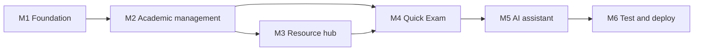

# 03. Scope and Roadmap

> Status: Draft v0.1 · Owner: Laxman Sirvi · Last updated: 2026-10-10

This document controls what gets built and in what order. Requirement IDs refer to [02-PRD.md](02-PRD.md). Task-level detail is in [16-implementation-plan.md](16-implementation-plan.md).

## 1. Release structure

The submission is every P0 requirement. It is built as three stacked releases so that each one is demonstrable on its own if time runs out.

| Release | Contains | Why it comes at this point |
| --- | --- | --- |
| **R1 Core platform** | Login and roles, academic records, admin CRUD, notices, resource hub, Quick Exam, progress rules | Everything else depends on accounts, subjects and content. |
| **R2 AI study assistant** | Explain, summarize, generate questions, usage limits | Needs login, subjects and the quiz result page. Carries external cost and risk. |
| **R3 Release hardening** | Security review, full test pass, Heroku deployment, demo data | Only meaningful once features are stable. |

P1 items start only after R3. P2 items are not planned.

## 2. R1 Core platform

| Milestone | Requirements | Complete when |
| --- | --- | --- |
| M1 Foundation | FR-AUTH-001 to 005, FR-UX-001 | A student and an admin log in, land on different dashboards, and are forced to change a temporary password. |
| M2 Academic management | FR-STU-001, FR-STU-002, FR-ATT-001, FR-ATT-002, FR-MRK-001, FR-MRK-002, FR-TT-001, FR-NOT-001, FR-ADM-001 to 006, FR-ADM-009 (write) | A student sees only their own sample data. An admin edit appears for the student and in the audit log. Cross-student access tests pass. |
| M3 Resource hub | FR-LIB-001 to 004, FR-ADM-007 | An admin uploads a PDF and a student finds, previews and bookmarks it. A non-PDF upload is rejected. |
| M4 Quick Exam | FR-QZ-001 to 004, FR-PRG-001, FR-PRG-002, FR-ADM-008 | A student completes a timed test, sees score and explanations, and a weak unit appears in recommendations. |

## 3. R2 AI study assistant

| Milestone | Requirements | Complete when |
| --- | --- | --- |
| M5 AI assistant | FR-AI-001 to 004 | All three AI features work against the mock provider and the real provider, fail gracefully, respect the daily limit, and pass the adversarial tests. |

M5 has two gates that need the owner: choosing a provider (OQ-1) and adding the API key.

## 4. R3 Release hardening

| Milestone | Complete when |
| --- | --- |
| M6 Test and deploy | The release criteria in [17-testing-strategy.md](17-testing-strategy.md) pass, the application runs on Heroku, and both success flows in the [charter](01-project-charter.md#8-success-criteria) run on the live URL. |

## 5. After the submission (P1)

In this order, because each is small and independent:

1. FR-ATT-003 Attendance calculator.
2. FR-PLN-001 Study tasks and FR-PLN-002 Exam countdown.
3. FR-ADM-009 Audit log viewer.
4. FR-AI-005 Summarize a library PDF.
5. FR-AI-006 Flowchart generation.
6. FR-LIB-005 Report a resource.
7. FR-ADM-010 CSV bulk import.
8. Session storage in the database, so a restart does not log users out.

## 6. Future enhancements (P2 and beyond)

| Feature | Notes |
| --- | --- |
| AI answers grounded in college notes | Needs text extraction for all resources and a retrieval step. |
| Question paper analyzer (FR-LIB-006) | Needs extracted text and unit tagging. |
| Flashcards (FR-AI-007) | |
| Search inside PDF text | Needs stored extracted text and a full-text index. |
| Faculty portal | New role and per-subject permissions; changes the authorization matrix. |
| Usage statistics (FR-ADM-011) | |
| OCR, study groups, voice assistant | Not planned. |

## 7. Explicitly excluded

- Any Node.js, Express or second backend service.
- A frontend framework or build pipeline.
- Self-registration and email-based password reset.
- Fee payment, admissions, hostel, library lending.
- Mobile apps.
- Using AI to score tests or to state official records.
- Predicting future exam questions.
- Real student data in any environment.

## 8. Dependencies between milestones

M4 depends on M3 only for revision recommendations, which link to resources.

## 9. Scope rules

1. Nothing outside the PRD is built. A new idea becomes a GitHub issue, not code.
2. A milestone is not started until the previous one meets its "complete when" line.
3. If the deadline (OQ-5) is at risk, cut in this order: M5 real provider (demo with the mock), then FR-PRG-002, then FR-LIB-004. Login, academic records and access control are never cut.
4. Changing a P0 requirement needs the owner's approval and an update to the PRD in the same change.

## 10. Risks of building advanced features too early

| If this is built early | This goes wrong |
| --- | --- |
| AI features before authentication | No way to limit use per user; cost and abuse are uncontrolled. |
| AI features before the resource hub and quiz | The assistant has nothing to connect to and becomes a generic chatbot. |
| PDF text extraction before uploads are validated | Malformed files reach the parser. |
| Flowcharts before structured AI output is validated | Unsafe or broken diagram text reaches the browser. |
| Recommendations before quiz scoring is trusted | Advice is built on wrong numbers. |
| Deployment before access-control tests exist | A public URL exposes records. |
