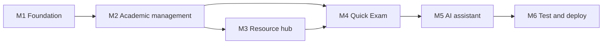

# 03. Scope and Roadmap

> Status: Draft v0.2 · Owner: Laxman Sirvi · Last updated: 2026-10-11

This document controls what gets built and in what order. Requirement IDs refer to [02-PRD.md](02-PRD.md). Task-level detail is in [16-implementation-plan.md](16-implementation-plan.md).

## 1. Release structure

The submission is **every P0 requirement in the [PRD](02-PRD.md)**. It is built as three stacked releases so that progress can be shown at each stage. Finishing an earlier release alone is **not** a complete submission. Reducing what is submitted needs an approved scope change (section 9).

| Release | Contains | Why it comes at this point |
| --- | --- | --- |
| **R1 Core platform** | Login and roles, academic records, admin CRUD, notices, resource hub, Quick Exam, progress rules | Everything else depends on accounts, subjects and content. |
| **R2 AI study assistant** | Explain, summarize, generate questions, usage limits | Needs login, subjects and the quiz result page. Carries external cost and risk. |
| **R3 Release hardening** | Security review, full test pass, Heroku deployment, demo data | Only meaningful once features are stable. |

P1 items start only after R3. P2 items are not planned.

## 2. R1 Core platform

| Milestone | Requirements | Complete when |
| --- | --- | --- |
| M1 Foundation | FR-AUTH-001 to 006, FR-UX-001 | A student logs in with an institutional email, an admin with an administrator email; they land on different dashboards; a temporary password must be changed before anything else works. |
| M2 Academic management | FR-STU-001, FR-STU-002, FR-ATT-001, FR-ATT-002, FR-MRK-001, FR-MRK-002, FR-TT-001, FR-NOT-001, FR-ADM-001 to 006, FR-ADM-009 (write) | A student sees only their own sample data. An admin edit appears for the student and in the audit log. Cross-student access tests pass. |
| M3 Resource hub | FR-LIB-001 to 004, FR-ADM-007 | An admin uploads a PDF and a student finds, previews and bookmarks it. A non-PDF upload is rejected. |
| M4 Quick Exam | FR-QZ-001 to 004, FR-PRG-001, FR-PRG-002, FR-ADM-008 | A student completes a timed test, sees score and explanations, and a weak unit appears in recommendations. |

## 3. R2 AI study assistant

| Milestone | Requirements | Complete when |
| --- | --- | --- |
| M5 AI assistant | FR-AI-001 to 004 | All three AI features work against the mock provider **and a real provider**, fail gracefully, respect the per-user limit and the application-wide ceiling, and pass the adversarial tests. |

M5 has two gates that need the owner: choosing a provider (OQ-1) and adding the API key.

### Is the real provider required for acceptance?

**Yes, as the documents stand.** FR-AI-001 to FR-AI-003 are P0 and are accepted only when they work with a real AI provider (task `T5-06`).

The mock provider has three approved uses:

1. Development, so AI work never waits for a key or costs money.
2. Every automated test.
3. A contingency on the day of a demonstration, if the provider is unavailable **after** acceptance with the real provider has already been recorded.

Submitting with the mock provider only is **not approved**. It would reduce three P0 requirements and is an open owner decision (OQ-9), best taken after asking the course instructor whether a mocked integration is acceptable.

## 4. R3 Release hardening

| Milestone | Complete when |
| --- | --- |
| M6 Test and deploy | The release criteria in [17-testing-strategy.md](17-testing-strategy.md) pass, the application runs on Heroku, and both success flows in the [charter](01-project-charter.md#8-success-criteria) run on the live URL. |

## 5. After the submission (P1)

In this order, because each is small and independent:

1. FR-ATT-003 Attendance calculator.
2. FR-PLN-001 Study tasks and FR-PLN-002 Exam countdown.
3. FR-ADM-009 Audit log viewer.
4. FR-AI-005 Summarize a library PDF.
5. FR-AI-006 Flowchart generation.
6. FR-LIB-005 Report a resource.
7. FR-ADM-010 CSV bulk import. Built on 2026-10-14, ahead of the others, so the owner can load the students in one step.
8. Session storage in the database, so a restart does not log users out.

## 6. Future enhancements (P2 and beyond)

| Feature | Notes |
| --- | --- |
| AI answers grounded in college notes | Needs text extraction for all resources and a retrieval step. |
| Question paper analyzer (FR-LIB-006) | Needs extracted text and unit tagging. |
| Flashcards (FR-AI-007) | |
| Search inside PDF text | Needs stored extracted text and a full-text index. |
| Faculty portal | New role and per-subject permissions; changes the authorization matrix. |
| Usage statistics (FR-ADM-011) | |
| OCR, study groups, voice assistant | Not planned. |

## 7. Explicitly excluded

- Any Node.js, Express or second backend service.
- A frontend framework or build pipeline.
- Self-registration, sending email, verifying email addresses, and email-based password reset.
- Fee payment, admissions, hostel, library lending.
- Mobile apps.
- Using AI to score tests or to state official records.
- Predicting future exam questions.
- Real student data in any environment.

## 8. Dependencies between milestones

M4 depends on M3 only for revision recommendations, which link to resources.

## 9. Scope rules

1. Nothing outside the PRD is built. A new idea becomes a GitHub issue, not code.
2. A milestone is not started until the previous one meets its "complete when" line.
3. **No P0 requirement is cut by default.** If the deadline (OQ-5) is at risk, the only route is the scope-change procedure below. No contributor or coding agent may apply it on their own.
4. Changing a P0 requirement needs the owner's approval and an update to the PRD in the same change.

### Scope-change procedure

1. Open a GitHub issue naming the requirement, the reason, and what would be delivered instead.
2. The owner decides. Where the change affects how the assignment is assessed, the owner confirms with the course instructor first.
3. If approved, one change does all of the following:
   - updates the requirement's priority or text in the [PRD](02-PRD.md), with the reason and the date;
   - adds a row to the scope-change log below;
   - updates the traceability matrix in [16-implementation-plan.md](16-implementation-plan.md), the release criteria in [17-testing-strategy.md](17-testing-strategy.md) and the [demo guide](demo-and-viva-guide.md).
4. Until step 3 is complete, the requirement remains P0 and required.

### Candidates the owner may consider

**None of these is approved.** They are listed in order of least damage, so the owner has a starting point if a cut becomes necessary.

| Order | Candidate | What would be lost |
| --- | --- | --- |
| 1 | Accept FR-AI-001 to FR-AI-003 with the mock provider only (defer `T5-06`) | No real model is called. The Java integration, limits, validation and UI are still shown. Decided under OQ-9. |
| 2 | Defer FR-PRG-002 (revision recommendations) | Weak units are still identified (FR-PRG-001), but no resources are suggested for them. |
| 3 | Defer FR-LIB-004 (bookmarks) | Students can still find, preview and download resources. |

Never candidates: authentication, role and ownership enforcement, academic records, audit writing, and upload validation.

### Scope-change log

| Date | Requirement | Change | Reason | Approved by |
| --- | --- | --- | --- | --- |
| 2026-10-11 | FR-AUTH-001, FR-AUTH-003, FR-AUTH-005, FR-ADM-001 (revised); FR-AUTH-006 (new, P0) | Students log in with an institutional email address instead of a roll number. A new student's temporary password is the roll number, which must be changed at first login. Lockout no longer reveals whether an account exists. | Owner's change request. The roll-number temporary password is a recorded security exception ([ADR 0008](decisions/0008-institutional-email-login.md)). | Owner |
| 2026-10-14 | FR-STU-002 (revised); FR-STU-003, FR-STU-004, FR-LEG-001 (new, P0) | A student may change their phone number, a short text about themselves and a profile photo. The college's fields stay read-only. A Settings page and a public privacy policy and terms of use are added. | Owner's change request. A student-facing upload and one more host in the Content-Security-Policy are recorded in [ADR 0009](decisions/0009-student-personal-details-and-photo.md). | Owner |
| 2026-10-14 | FR-UX-002 (new, P1) | A public landing page at the site's address. A logged-in user is sent on to their dashboard. | Owner's request; built last as asked. | Owner |

## 10. Risks of building advanced features too early

| If this is built early | This goes wrong |
| --- | --- |
| AI features before authentication | No way to limit use per user; cost and abuse are uncontrolled. |
| AI features before the resource hub and quiz | The assistant has nothing to connect to and becomes a generic chatbot. |
| PDF text extraction before uploads are validated | Malformed files reach the parser. |
| Flowcharts before structured AI output is validated | Unsafe or broken diagram text reaches the browser. |
| Recommendations before quiz scoring is trusted | Advice is built on wrong numbers. |
| Deployment before access-control tests exist | A public URL exposes records. |
