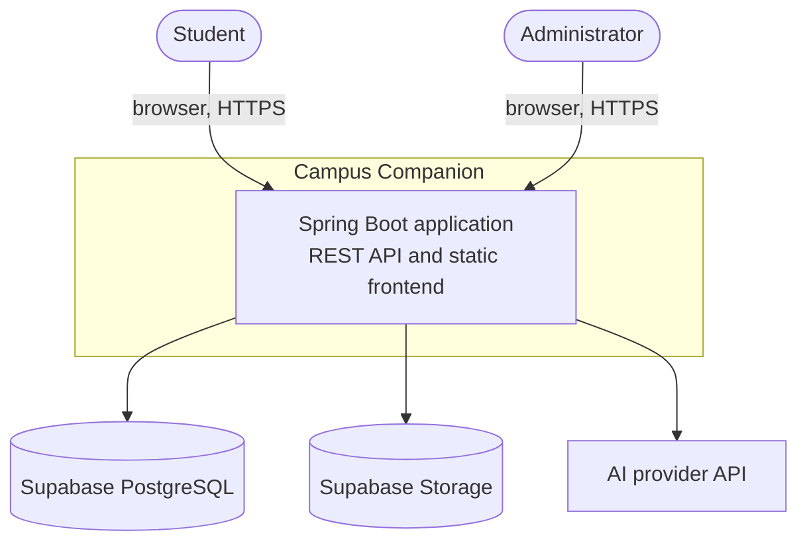
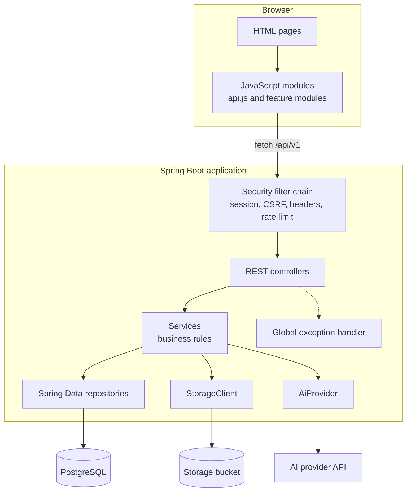
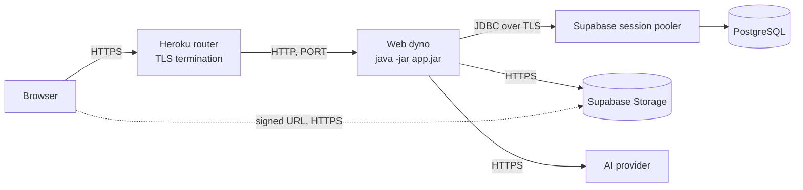
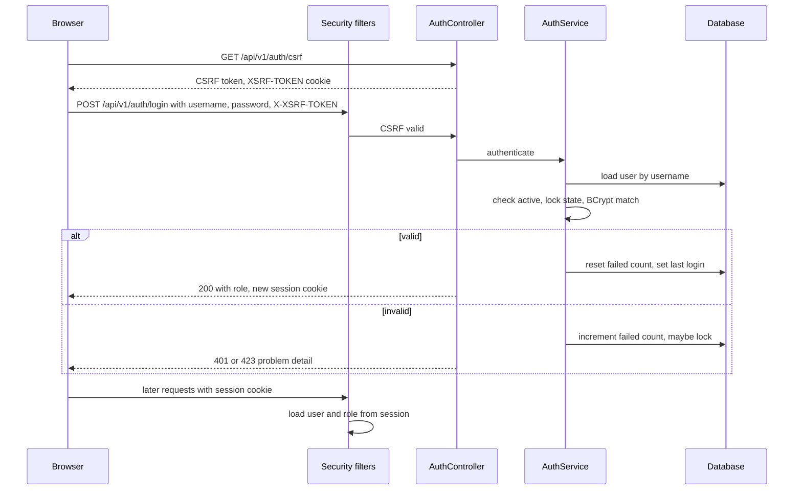
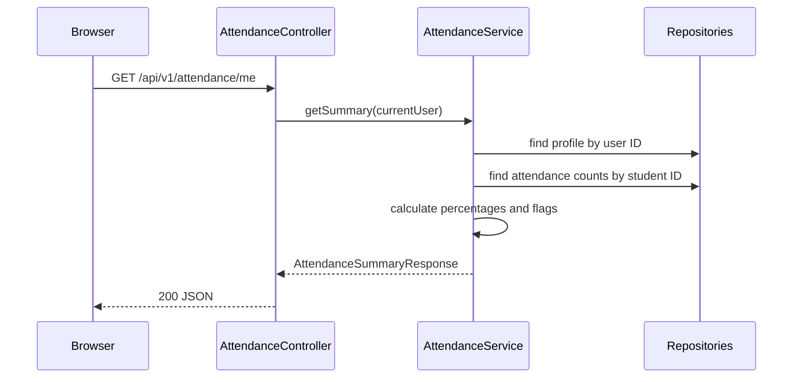
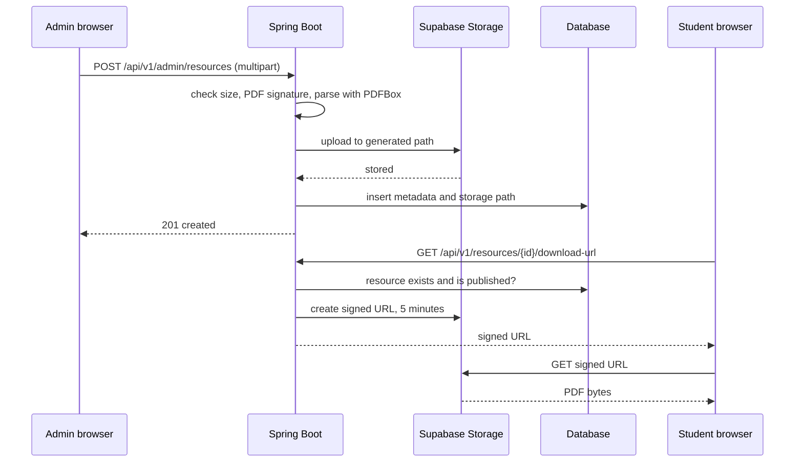
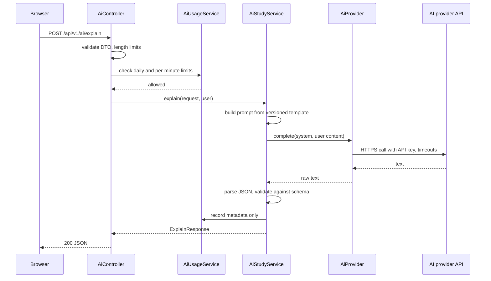
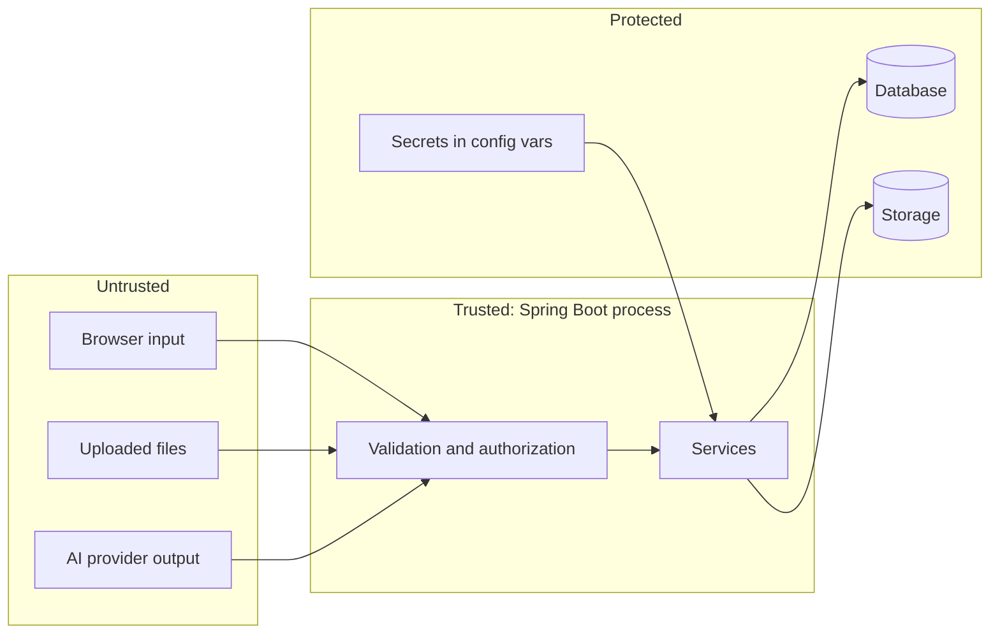

# 05. Architecture

> Status: Draft v0.1 · Owner: Laxman Sirvi · Last updated: 2026-10-10

## 1. System context



Campus Companion is one deployable application. It depends on three external services, all called only from the backend.

## 2. Components



| Component | Responsibility |
| --- | --- |
| Static frontend | Renders pages, calls the API, shows states. Holds no secrets and makes no access decisions. |
| Security filter chain | Authenticates the session, checks CSRF, sets security headers, limits request rates. |
| Controllers | Map HTTP to service calls. Validate request DTOs. No business logic. |
| Services | All business rules, ownership checks and transactions. |
| Repositories | Database access through Spring Data JPA. |
| `StorageClient` | Uploads, deletes and signs URLs in Supabase Storage. |
| `AiProvider` | Sends a prepared request to the AI provider and returns raw text. |
| Global exception handler | Turns exceptions into problem-detail responses. |

## 3. Deployment



- One web dyno runs one JAR. Sessions are held in memory, so a dyno restart logs users out (accepted for the first release).
- Configuration and secrets are Heroku config vars.
- Flyway migrates the schema when the application starts.

See [18-production-plan.md](18-production-plan.md).

## 4. Package structure

```
com.campuscompanion
├── CampusCompanionApplication.java
├── common
│   ├── config        // properties classes, clock, RestClient beans
│   ├── error         // exceptions, error codes, GlobalExceptionHandler
│   ├── security      // SecurityConfig, CurrentUser, RateLimitFilter
│   └── web           // PageResponse, request ID filter
├── auth              // login, logout, password change, lockout
├── student           // profiles, dashboard
├── subject           // subjects and units
├── attendance
├── assessment        // assessments, marks, semester results
├── timetable
├── notice
├── resource          // learning resources, question papers, bookmarks, storage
├── quiz              // question bank, attempts, evaluation
├── progress          // unit performance, recommendations
├── planner           // study tasks (P1)
├── ai                // provider, prompts, parsing, usage
└── audit
```

Each feature package contains `controller`, `service`, `repository`, `entity` and `dto` classes. Admin endpoints live in the feature they manage (for example `attendance.AdminAttendanceController`), not in a separate admin package.

**Dependency rule:** a feature may depend on `common` and on another feature's *service* interface. It never uses another feature's repository or entity directly.

## 5. Authentication flow



- The session ID changes at login to prevent session fixation.
- The session stores the user ID and role only. The student profile is looked up from the user ID on each request that needs it.

## 6. Data flow for an academic read



The student ID never comes from the browser. Endpoints ending in `/me` take no student identifier at all.

## 7. Data flow for an admin write

1. The controller validates the request DTO.
2. The service opens a transaction, loads the current values and applies the business rules (for example, marks not above the maximum).
3. The service saves the change and writes an audit entry in the **same transaction**.
4. If anything fails, both the change and the audit entry roll back.

## 8. File upload and download



- The storage path is generated by the server (`resources/{subjectCode}/{uuid}.pdf`). The uploaded file name is stored only for display.
- If the database insert fails after the upload, the service deletes the stored object. A scheduled cleanup of orphaned objects is a P1 task.

## 9. AI request and response



- The prompt contains the student's input and, at most, subject and unit names. It never contains records from the database.
- The AI service has no access to repositories other than its own usage log.

## 10. Error handling and external failures

| Failure | Behaviour |
| --- | --- |
| Validation error | 400 with field errors. |
| Not logged in | 401. The frontend redirects to login. |
| Wrong role | 403. |
| Not found, or not the owner | 404. |
| Database unavailable | 503 from the global handler; health check reports DOWN. |
| Storage unavailable | 503 `STORAGE_UNAVAILABLE` on that request only. Listings still work. |
| AI timeout, error or invalid output | 504, 503 or 502 with an AI error code. Not counted against the user's limit. |
| Unexpected exception | 500 `INTERNAL_ERROR` with a `traceId`. Details are logged, not returned. |

## 11. Trust boundaries



Security-sensitive interactions:

1. **Browser to API:** everything from the browser is untrusted, including IDs, roles and hidden fields.
2. **Uploads:** a file is hostile until validated. It is never executed or served from the application's own origin.
3. **AI output:** treated as untrusted text. Parsed, validated, and rendered as text only.
4. **Backend to Supabase:** the service key and database password grant full access. They exist only in server configuration.
5. **Signed URLs:** the one place the browser talks to storage directly. They are short-lived and issued only after an authorization check.

## 12. Constraints and decisions

| Constraint | Decision record |
| --- | --- |
| One backend, in Java with Spring Boot | [0001](decisions/0001-spring-boot-as-sole-backend.md) |
| Supabase PostgreSQL and Storage, accessed from Java only | [0002](decisions/0002-supabase-postgresql-and-storage.md) |
| Frontend and backend deployed as one application | [0003](decisions/0003-single-deployable-application.md) |
| Session-cookie authentication | [0004](decisions/0004-session-cookie-authentication.md) |
| AI behind a Java interface, server-side only | [0005](decisions/0005-ai-integration-behind-java-interface.md) |
| Flyway migrations | [0006](decisions/0006-flyway-database-migrations.md) |
