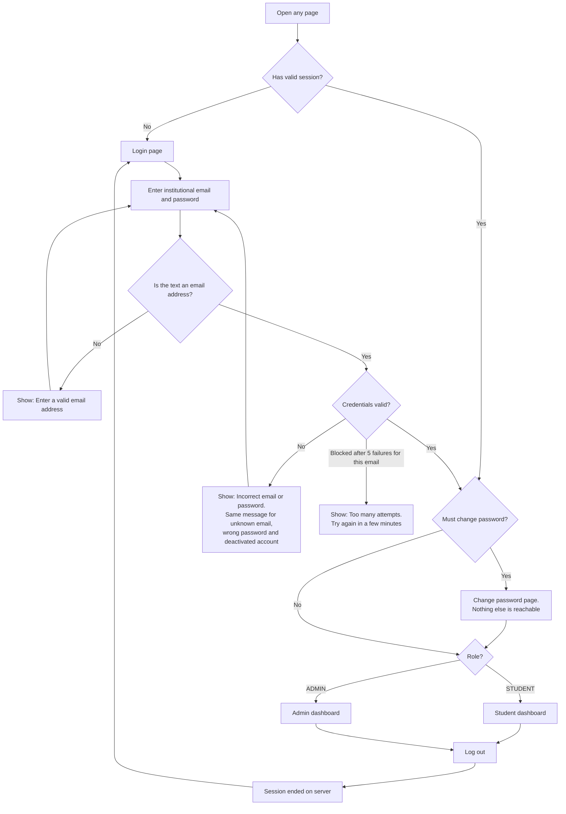
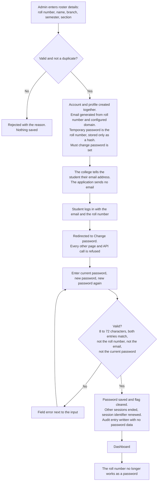
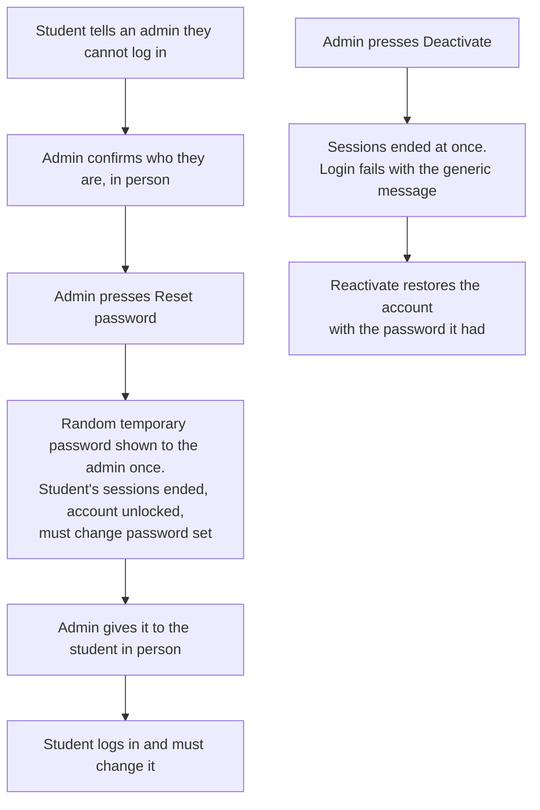
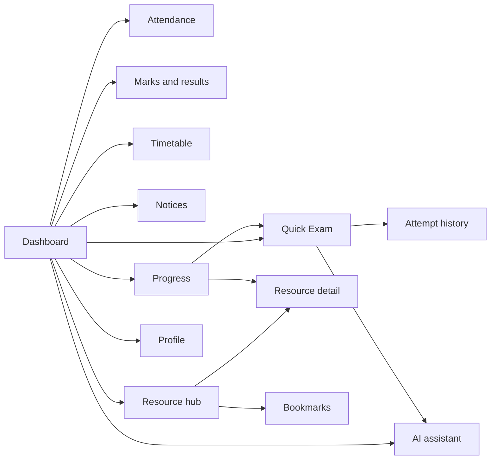
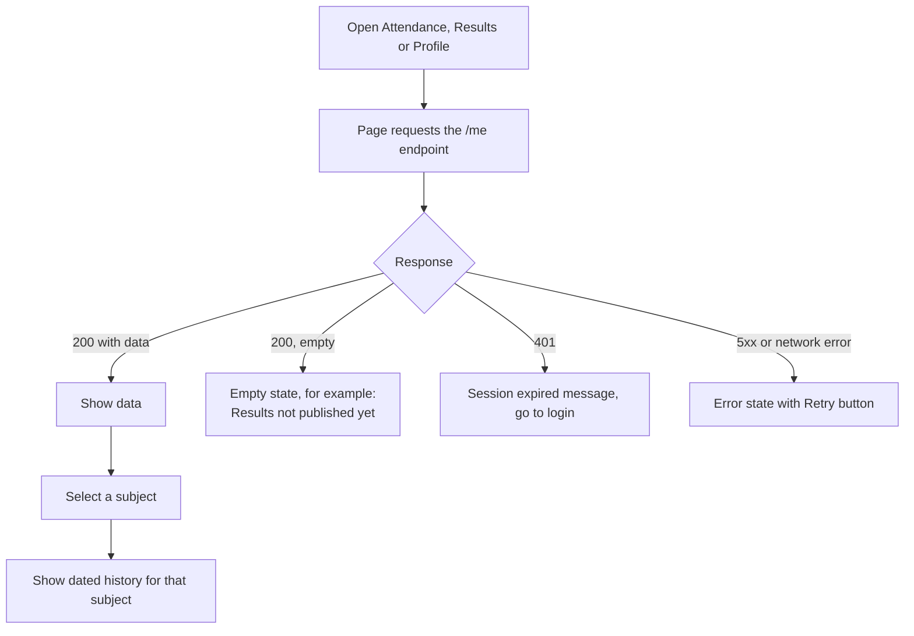
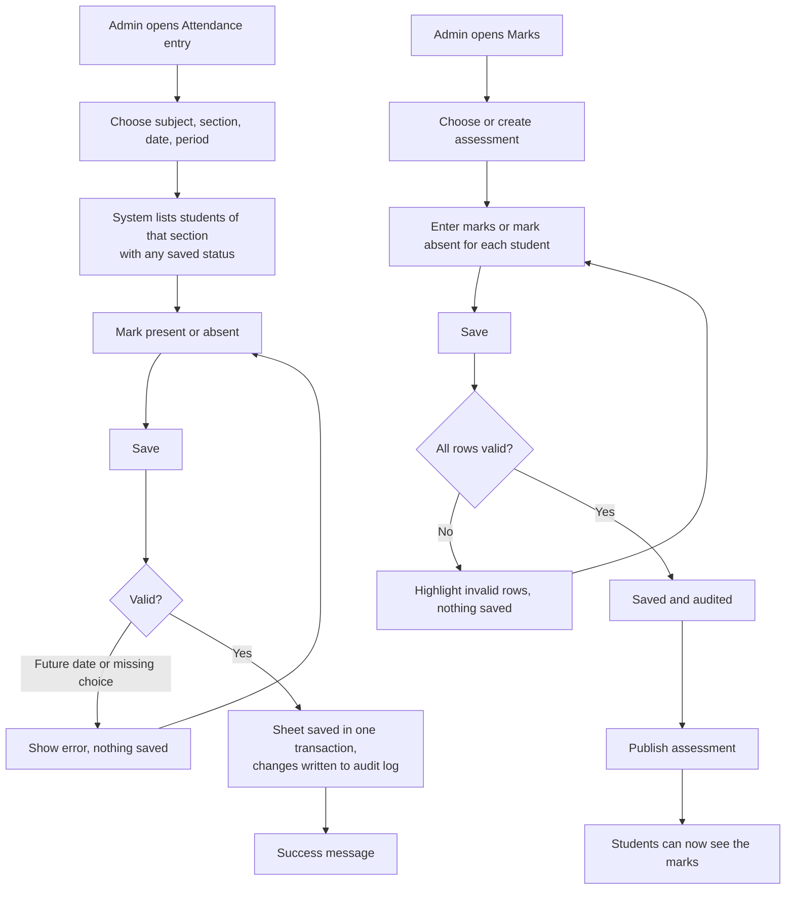
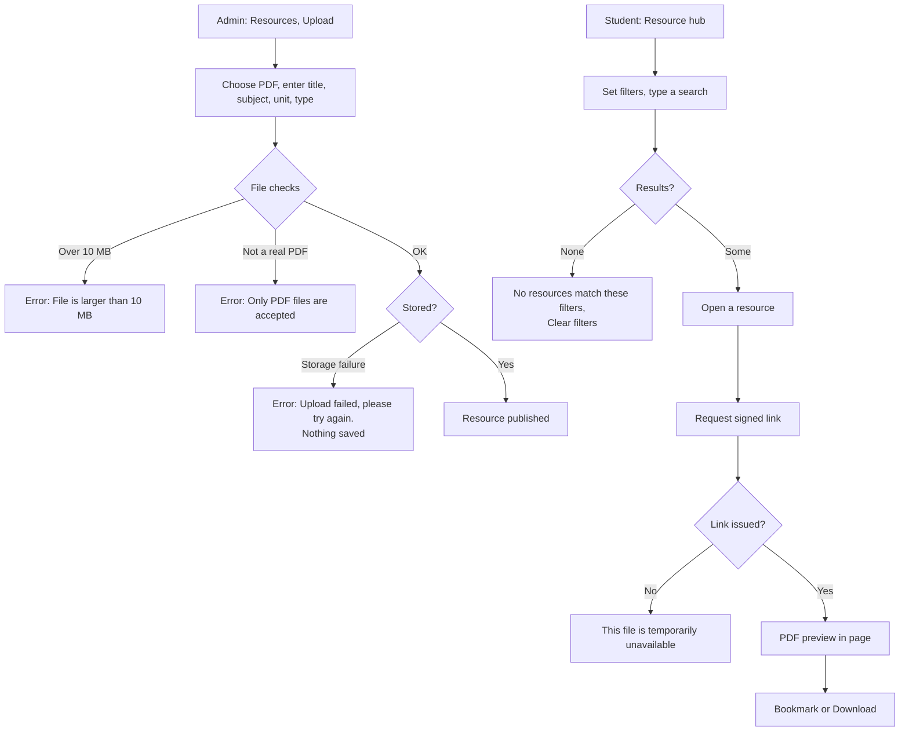
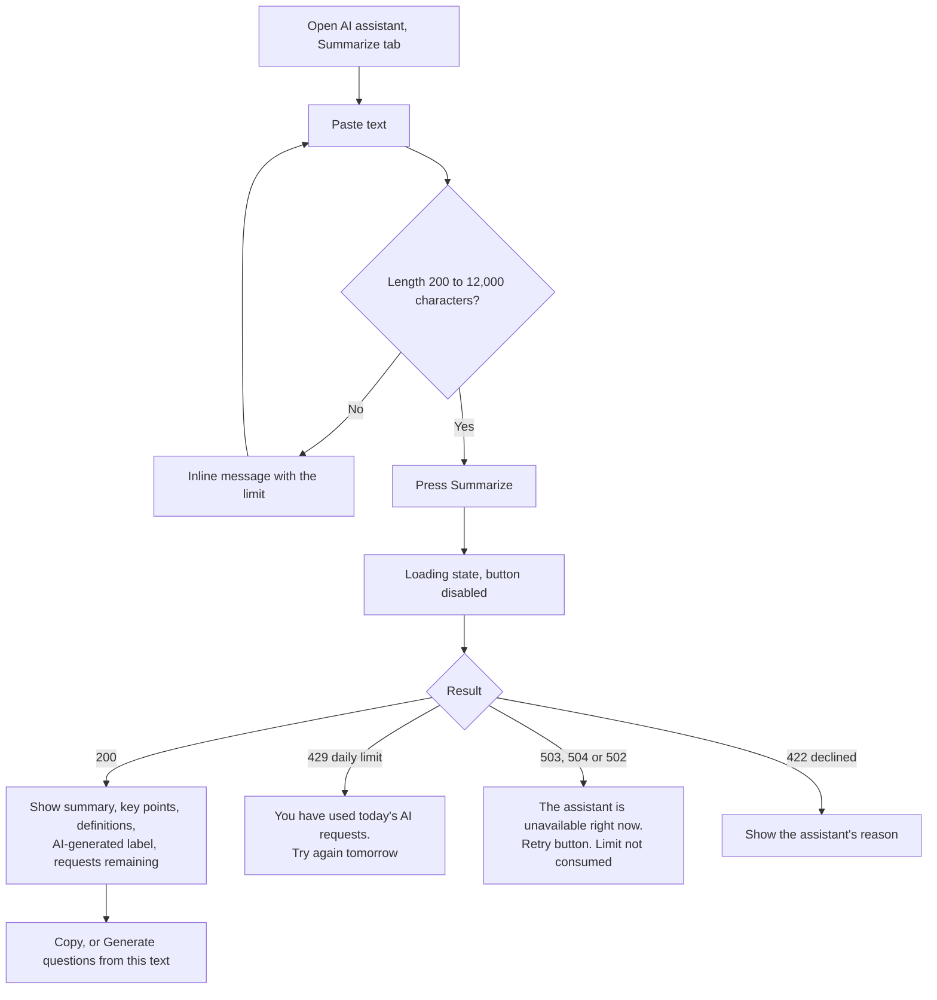
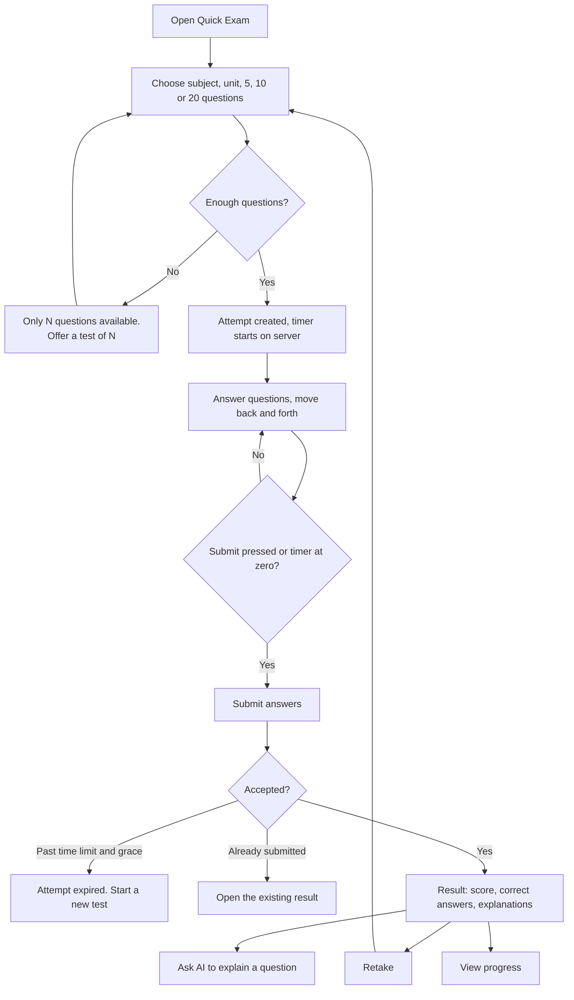

# 06. App Flow

> Status: Draft v0.2 · Owner: Laxman Sirvi · Last updated: 2026-10-11

This document describes how users move through the application and what happens at each step.

## 1. Screens

| Area | Path | Screen |
| --- | --- | --- |
| Public | `/login.html` | Login |
| Shared | `/change-password.html` | Change password |
| Student | `/student/dashboard.html` | Dashboard |
| Student | `/student/profile.html` | Profile |
| Student | `/student/attendance.html` | Attendance |
| Student | `/student/results.html` | Marks and results |
| Student | `/student/timetable.html` | Timetable |
| Student | `/student/notices.html` | Notices |
| Student | `/student/resources.html` | Resource hub |
| Student | `/student/resource.html?id=` | Resource detail and PDF preview |
| Student | `/student/bookmarks.html` | Bookmarks |
| Student | `/student/quiz.html` | Quick Exam: set up, take, result |
| Student | `/student/quiz-history.html` | Attempt history |
| Student | `/student/progress.html` | Progress and recommendations |
| Student | `/student/assistant.html` | AI study assistant |
| Admin | `/admin/dashboard.html` | Admin home |
| Admin | `/admin/students.html` | Students |
| Admin | `/admin/subjects.html` | Subjects and units |
| Admin | `/admin/attendance.html` | Attendance entry |
| Admin | `/admin/marks.html` | Assessments and marks |
| Admin | `/admin/results.html` | Semester results |
| Admin | `/admin/timetable.html` | Timetable |
| Admin | `/admin/notices.html` | Notices |
| Admin | `/admin/resources.html` | Resources |
| Admin | `/admin/questions.html` | Question bank |

## 2. Navigation rules

1. Without a session, every page except `/login.html` redirects to login.
2. Static files under `/student/` are served only to `STUDENT`, and under `/admin/` only to `ADMIN`. The other role is redirected to its own dashboard.
3. An account that must change its password is redirected to `/change-password.html` from every page.
4. The root path `/` redirects to the dashboard for the user's role, or to login.
5. After login, the user goes to their dashboard, not to a page named in a URL parameter. This avoids open redirects.

## 3. Login and logout (student and admin)

The flow is the same for both roles. Students enter their institutional email address; admins enter their administrator email address. Only the destination differs.

The login form has two labelled fields, "Institutional email" and "Password". It does not accept a roll number on its own, and it never says whether an email address has an account.

## 4. Account provisioning and first-time password

There is no self-registration. Admin accounts do not go through this flow: they are provisioned separately and never get a roll-number password.

### Password reset and deactivation

A reset never restores the roll number as the password.

## 5. Student dashboard navigation

Every student page has the same navigation, so any screen is one step from any other.

## 6. Viewing profile and academic records

## 7. Admin updating attendance and marks

## 8. Uploading and finding learning materials

## 9. Generating an AI summary

## 10. Taking a Quick Exam

## 11. Common failure handling

| Situation | What the user sees | What happens next |
| --- | --- | --- |
| Session expired | "Your session has expired. Please log in again." | Redirect to login after the message. |
| Access denied (403) | "You do not have permission to do this." | Stay on the page. |
| Record not found (404) | "We could not find that." with a link back to the list. | |
| Missing data | The empty state for that list or card. | No error styling. |
| Validation error | Messages next to the fields; the form keeps its values. | Focus moves to the first invalid field. |
| Failed upload | "Upload failed. Please try again." | The form keeps the metadata. |
| Server error (5xx) | "Something went wrong on our side. Please try again." and a reference code. | Retry button. |
| Offline or network failure | "You appear to be offline." | Retry button. |
| Rate limited (429) | "Too many requests. Please wait a moment." | Controls re-enable after the wait time. |
