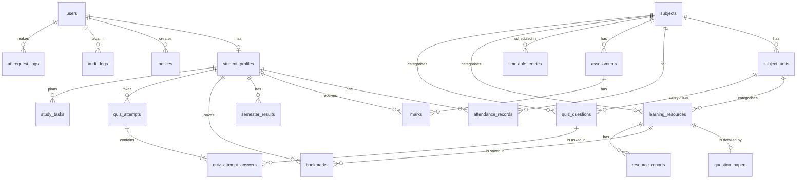

# 08. Database Design

> Status: Draft v0.2 · Owner: Laxman Sirvi · Last updated: 2026-10-11

The Flyway migration files in `src/main/resources/db/migration` MUST match this document. If they differ, fix one of them in the same change.

## 1. Systems of record

| Data | Authoritative system |
| --- | --- |
| Accounts, academic records, metadata, quiz data, logs | Supabase PostgreSQL |
| PDF files | Supabase Storage (private bucket). The database holds the path and metadata, never the bytes. |
| Sessions | Application memory (first release) |
| Secrets | Heroku config vars |
| AI prompts and responses | Not stored anywhere |

## 2. Conventions

- Schema `app`, a dedicated schema that the Supabase Data API does not expose. Nothing is created in `public`. Table and column names in `snake_case`, tables plural.
- Primary keys: `id BIGINT GENERATED ALWAYS AS IDENTITY`, unless stated.
- Timestamps: `TIMESTAMPTZ`, stored in UTC. `created_at` defaults to `now()`.
- Enumerated values: `VARCHAR` with a `CHECK` constraint, mapped to Java enums by name.
- Marks, percentages and grade points: `NUMERIC`, never floating point.
- Every foreign key column is indexed.
- Every application table has Row Level Security enabled, explicit grants, and policies for the runtime role only. The full model is in [section 11](#11-database-security-model).
- Deleting is rare. Records that are referenced are deactivated, hidden or retired instead.

## 3. Entity-relationship diagram



## 4. Data dictionary

### 4.1 `users`

Login identity, credentials and account state for both roles. One row per account.

| Column | Type | Constraints | Notes |
| --- | --- | --- | --- |
| id | BIGINT | PK | Internal account ID. The only identity held in a session. |
| login_email | VARCHAR(254) | NOT NULL, UNIQUE; CHECK equals `lower(btrim(login_email))`; CHECK has the form `local@domain` | The login identifier of every account, stored normalised. For a student: the roll number in lower case, `@`, the configured domain. Generated at provisioning and never edited through the application. |
| password_hash | VARCHAR(100) | NOT NULL | BCrypt hash, salted. The only form in which any password, including a temporary one, is stored. |
| role | VARCHAR(20) | NOT NULL, CHECK in (`STUDENT`, `ADMIN`) | |
| display_name | VARCHAR(120) | NOT NULL | |
| active | BOOLEAN | NOT NULL, default true | False means deactivated: login fails and existing sessions are ended. |
| must_change_password | BOOLEAN | NOT NULL, default true | True for every newly provisioned or reset account. Cleared only by a successful password change. |
| failed_login_count | SMALLINT | NOT NULL, default 0 | Consecutive failures since the last success. |
| locked_until | TIMESTAMPTZ | NULL | Set 15 minutes ahead on the fifth consecutive failure. |
| last_login_at | TIMESTAMPTZ | NULL | NULL means the account has never been used. |
| created_at, updated_at | TIMESTAMPTZ | NOT NULL | |

Design notes:

- **One login column for both roles.** There is no `username`, and a roll number is not stored in this table.
- **Uniqueness is on the normalised value.** The CHECK constraint means a value that is not trimmed and lower case cannot be stored at all, so `A@x.example` and `a@x.example` can never both exist. Java normalises before every lookup and write; the database refuses anything that slipped through.
- **The domain is not checked here.** It is configuration (`STUDENT_EMAIL_DOMAIN`), which SQL cannot see. That a student's email matches their roll number and the configured domain is enforced by `StudentProvisioningService`.
- **Failed attempts for emails that have no account** have no row to count in. They are tracked in application memory with the same thresholds, so the response is the same either way ([02-PRD.md](02-PRD.md) FR-AUTH-005).

**Account states.** There is no status column; the state follows from the columns above.

| State | Condition | Login |
| --- | --- | --- |
| Awaiting first login | `active`, `must_change_password`, `last_login_at` is NULL | Allowed with the temporary password, then the password must be changed |
| Password change pending | `active`, `must_change_password`, `last_login_at` is set (after an admin reset) | Allowed, then the password must be changed |
| Active | `active`, not `must_change_password` | Allowed |
| Locked | `locked_until` is in the future | Refused until the time passes or an admin resets the password |
| Deactivated | not `active` | Refused |

### 4.2 `student_profiles`

| Column | Type | Constraints | Notes |
| --- | --- | --- | --- |
| id | BIGINT | PK | The "student ID" used by other tables. |
| user_id | BIGINT | NOT NULL, UNIQUE, FK → users | Links the profile to its account, one to one. |
| roll_no | VARCHAR(20) | NOT NULL, UNIQUE; CHECK equals `upper(roll_no)`; CHECK letters and digits only | The academic identifier, stored in upper case. It is not the login identifier. The login email is derived from it once, at provisioning. |
| full_name | VARCHAR(120) | NOT NULL | |
| branch | VARCHAR(20) | NOT NULL | For example `CSE`. |
| current_semester | SMALLINT | NOT NULL, CHECK 1 to 8 | |
| section | VARCHAR(5) | NOT NULL | |
| admission_year | SMALLINT | NOT NULL, CHECK 2000 to 2100 | |
| phone | VARCHAR(20) | NULL | The student may change it (FR-STU-003). |
| bio | VARCHAR(280) | NULL | A few lines the student writes about themselves. Added in V6. |
| photo_path | VARCHAR(300) | NULL, UNIQUE | Where the profile photo is kept in file storage. Generated by the server; the photo itself is never in the database. Added in V6. |
| created_at, updated_at | TIMESTAMPTZ | NOT NULL | |

Index: (`branch`, `current_semester`, `section`).

**There is no email column in this table.** A student's institutional email is `users.login_email`. Storing it a second time would let the two drift apart.

Every `STUDENT` account has exactly one profile, and an `ADMIN` account has none. That rule spans two tables, so it is enforced by `StudentProvisioningService`, which creates both rows in one transaction, and checked by an integration test.

### 4.3 `subjects`

| Column | Type | Constraints | Notes |
| --- | --- | --- | --- |
| id | BIGINT | PK | |
| code | VARCHAR(20) | NOT NULL, UNIQUE | For example `CS301`. |
| name | VARCHAR(150) | NOT NULL | |
| branch | VARCHAR(20) | NOT NULL | |
| semester | SMALLINT | NOT NULL, CHECK 1 to 8 | |
| credits | SMALLINT | NOT NULL, CHECK 0 to 10 | |
| active | BOOLEAN | NOT NULL, default true | |

Index: (`branch`, `semester`).

### 4.4 `subject_units`

| Column | Type | Constraints |
| --- | --- | --- |
| id | BIGINT | PK |
| subject_id | BIGINT | NOT NULL, FK → subjects |
| unit_no | SMALLINT | NOT NULL, CHECK 1 to 20 |
| title | VARCHAR(200) | NOT NULL |

Unique: (`subject_id`, `unit_no`).

### 4.5 `attendance_records`

One row per student per class held.

| Column | Type | Constraints | Notes |
| --- | --- | --- | --- |
| id | BIGINT | PK | |
| student_id | BIGINT | NOT NULL, FK → student_profiles | |
| subject_id | BIGINT | NOT NULL, FK → subjects | |
| class_date | DATE | NOT NULL | Not in the future (checked in Java). |
| period_no | SMALLINT | NOT NULL, default 1, CHECK 1 to 12 | |
| status | VARCHAR(10) | NOT NULL, CHECK in (`PRESENT`, `ABSENT`) | |
| marked_by | BIGINT | NOT NULL, FK → users | |
| created_at, updated_at | TIMESTAMPTZ | NOT NULL | |

Unique: (`student_id`, `subject_id`, `class_date`, `period_no`). Index: (`subject_id`, `class_date`).

### 4.6 `assessments`

| Column | Type | Constraints | Notes |
| --- | --- | --- | --- |
| id | BIGINT | PK | |
| subject_id | BIGINT | NOT NULL, FK → subjects | |
| name | VARCHAR(100) | NOT NULL | For example "Internal 1". |
| assessment_type | VARCHAR(20) | NOT NULL, CHECK in (`INTERNAL`, `ASSIGNMENT`, `LAB`, `SEMESTER_EXAM`) | |
| max_marks | NUMERIC(5,2) | NOT NULL, CHECK > 0 | |
| held_on | DATE | NULL | |
| academic_year | VARCHAR(9) | NOT NULL | For example `2026-27`. |
| published | BOOLEAN | NOT NULL, default false | Students see marks only when true. |
| created_at | TIMESTAMPTZ | NOT NULL | |

Unique: (`subject_id`, `name`, `academic_year`).

### 4.7 `marks`

| Column | Type | Constraints | Notes |
| --- | --- | --- | --- |
| id | BIGINT | PK | |
| student_id | BIGINT | NOT NULL, FK → student_profiles | |
| assessment_id | BIGINT | NOT NULL, FK → assessments | The subject is reached through the assessment. |
| marks_obtained | NUMERIC(5,2) | NULL, CHECK >= 0 | NULL when absent. Not above `max_marks` (checked in Java). |
| absent | BOOLEAN | NOT NULL, default false | |
| entered_by | BIGINT | NOT NULL, FK → users | |
| updated_at | TIMESTAMPTZ | NOT NULL | |

Unique: (`student_id`, `assessment_id`). Check: `absent = true` or `marks_obtained IS NOT NULL`.

### 4.8 `semester_results`

| Column | Type | Constraints | Notes |
| --- | --- | --- | --- |
| id | BIGINT | PK | |
| student_id | BIGINT | NOT NULL, FK → student_profiles | |
| semester | SMALLINT | NOT NULL, CHECK 1 to 8 | |
| sgpa | NUMERIC(4,2) | NOT NULL, CHECK 0 to 10 | Official value entered by an admin. |
| credits_registered | SMALLINT | NOT NULL, CHECK > 0 | Total credits of every course registered in the semester, passed or failed. **This is the CGPA weight.** |
| credits_earned | SMALLINT | NOT NULL, CHECK >= 0 | Credits of the courses passed. Displayed; not used as a weight. |
| result_status | VARCHAR(10) | NOT NULL, CHECK in (`PASS`, `FAIL`, `WITHHELD`) | |
| published_at | TIMESTAMPTZ | NULL | Visible to the student when set. |
| updated_at | TIMESTAMPTZ | NOT NULL | |

Unique: (`student_id`, `semester`). Check: `credits_earned <= credits_registered`.

**CGPA is not stored.** `ResultService` calculates it on each read:

```
CGPA = Σ (sgpa × credits_registered) ÷ Σ (credits_registered)
```

- The sum runs over the student's **published** semesters whose status is `PASS` or `FAIL`. `WITHHELD` semesters are left out until they are resolved.
- The result is rounded to two decimals, `HALF_UP`.
- With no qualifying semester, CGPA is null.

**Why registered credits, not earned credits.** SGPA is itself an average over every course registered in the semester, with a failed course contributing zero grade points. Weighting each SGPA by the credits registered in that semester therefore gives exactly the average over all courses across all semesters. Weighting by credits earned would give a failed semester too little weight and overstate the CGPA. Example: semester 1 has SGPA 7.80 on 22 registered credits; semester 2 has SGPA 6.50 on 24 registered credits, of which 20 were earned. CGPA = (7.80 × 22 + 6.50 × 24) ÷ 46 = 7.12. Weighting by earned credits would wrongly give 7.18.

**Status:** this is the standard credit-weighted formula and is the documented default. The college's own regulation (grading scale, treatment of failed, repeated and withheld courses) is still to be confirmed by the owner under OQ-3 before task `T2-10`. If the regulation differs, this section, [02-PRD.md](02-PRD.md) FR-MRK-002 and the `ResultService` tests change together.

### 4.9 `timetable_entries`

| Column | Type | Constraints | Notes |
| --- | --- | --- | --- |
| id | BIGINT | PK | |
| branch | VARCHAR(20) | NOT NULL | |
| semester | SMALLINT | NOT NULL, CHECK 1 to 8 | |
| section | VARCHAR(5) | NOT NULL | |
| day_of_week | SMALLINT | NOT NULL, CHECK 1 to 7 | 1 is Monday. |
| start_time | TIME | NOT NULL | |
| end_time | TIME | NOT NULL, CHECK > start_time | |
| subject_id | BIGINT | NOT NULL, FK → subjects | |
| room | VARCHAR(30) | NULL | |
| faculty_name | VARCHAR(120) | NULL | |

Index: (`branch`, `semester`, `section`, `day_of_week`). Overlaps within a section are rejected in Java.

### 4.10 `notices`

| Column | Type | Constraints | Notes |
| --- | --- | --- | --- |
| id | BIGINT | PK | |
| title | VARCHAR(200) | NOT NULL | |
| body | TEXT | NOT NULL | Plain text, max 5,000 characters (checked in Java). |
| category | VARCHAR(20) | NOT NULL, CHECK in (`GENERAL`, `EXAM`, `ASSIGNMENT`, `EVENT`) | |
| target_branch | VARCHAR(20) | NULL | NULL means all branches. |
| target_semester | SMALLINT | NULL, CHECK 1 to 8 | NULL means all semesters. |
| due_date | DATE | NULL | Makes the notice a deadline. |
| status | VARCHAR(10) | NOT NULL, CHECK in (`DRAFT`, `PUBLISHED`) | |
| published_at | TIMESTAMPTZ | NULL | |
| created_by | BIGINT | NOT NULL, FK → users | |
| created_at, updated_at | TIMESTAMPTZ | NOT NULL | |

Index: (`status`, `published_at` DESC).

### 4.11 `learning_resources`

| Column | Type | Constraints | Notes |
| --- | --- | --- | --- |
| id | BIGINT | PK | |
| title | VARCHAR(200) | NOT NULL | |
| description | VARCHAR(1000) | NULL | |
| subject_id | BIGINT | NOT NULL, FK → subjects | |
| unit_id | BIGINT | NULL, FK → subject_units | NULL for whole-subject material. |
| resource_type | VARCHAR(30) | NOT NULL, CHECK in (`NOTES`, `SYLLABUS`, `LAB_MANUAL`, `QUESTION_PAPER`, `MODEL_PAPER`, `IMPORTANT_QUESTIONS`) | |
| storage_path | VARCHAR(300) | NOT NULL, UNIQUE | Generated by the server. |
| original_file_name | VARCHAR(255) | NOT NULL | Display only. |
| mime_type | VARCHAR(100) | NOT NULL | `application/pdf` in the first release. |
| file_size_bytes | BIGINT | NOT NULL, CHECK > 0 | |
| checksum_sha256 | CHAR(64) | NOT NULL | |
| version | SMALLINT | NOT NULL, default 1 | |
| status | VARCHAR(10) | NOT NULL, CHECK in (`PUBLISHED`, `HIDDEN`) | |
| uploaded_by | BIGINT | NOT NULL, FK → users | |
| created_at, updated_at | TIMESTAMPTZ | NOT NULL | |

Index: (`subject_id`, `unit_id`, `resource_type`), (`status`, `created_at` DESC). Search in the first release uses case-insensitive matching on `title` and `description`.

### 4.12 `question_papers`

Extra details for resources of type `QUESTION_PAPER` or `MODEL_PAPER`.

| Column | Type | Constraints |
| --- | --- | --- |
| resource_id | BIGINT | PK, FK → learning_resources ON DELETE CASCADE |
| exam_year | SMALLINT | NOT NULL, CHECK 2000 to 2100 |
| exam_type | VARCHAR(20) | NOT NULL, CHECK in (`INTERNAL`, `SEMESTER`, `SUPPLEMENTARY`, `MODEL`) |
| max_marks | SMALLINT | NULL, CHECK > 0 |

Index: (`exam_year`).

### 4.13 `bookmarks`

| Column | Type | Constraints |
| --- | --- | --- |
| student_id | BIGINT | NOT NULL, FK → student_profiles |
| resource_id | BIGINT | NOT NULL, FK → learning_resources ON DELETE CASCADE |
| created_at | TIMESTAMPTZ | NOT NULL |

Primary key: (`student_id`, `resource_id`).

### 4.14 `quiz_questions`

| Column | Type | Constraints | Notes |
| --- | --- | --- | --- |
| id | BIGINT | PK | |
| subject_id | BIGINT | NOT NULL, FK → subjects | |
| unit_id | BIGINT | NOT NULL, FK → subject_units | |
| question_text | VARCHAR(1000) | NOT NULL | |
| option_a, option_b, option_c, option_d | VARCHAR(300) | NOT NULL | |
| correct_option | CHAR(1) | NOT NULL, CHECK in (`A`, `B`, `C`, `D`) | Never sent to a student before submission. |
| explanation | VARCHAR(2000) | NOT NULL | |
| difficulty | VARCHAR(10) | NOT NULL, CHECK in (`EASY`, `MEDIUM`, `HARD`) | |
| source | VARCHAR(20) | NOT NULL, CHECK in (`ADMIN`, `AI_GENERATED`) | |
| status | VARCHAR(10) | NOT NULL, CHECK in (`DRAFT`, `PUBLISHED`, `RETIRED`) | |
| created_by | BIGINT | NOT NULL, FK → users | |
| created_at, updated_at | TIMESTAMPTZ | NOT NULL | |

Index: (`subject_id`, `unit_id`, `status`).

### 4.15 `quiz_attempts`

| Column | Type | Constraints | Notes |
| --- | --- | --- | --- |
| id | BIGINT | PK | |
| student_id | BIGINT | NOT NULL, FK → student_profiles | |
| subject_id | BIGINT | NOT NULL, FK → subjects | |
| unit_id | BIGINT | NOT NULL, FK → subject_units | |
| question_count | SMALLINT | NOT NULL, CHECK 1 to 20 | |
| started_at | TIMESTAMPTZ | NOT NULL | |
| expires_at | TIMESTAMPTZ | NOT NULL | `started_at` + 60 s × `question_count`. |
| submitted_at | TIMESTAMPTZ | NULL | |
| status | VARCHAR(15) | NOT NULL, CHECK in (`IN_PROGRESS`, `SUBMITTED`, `EXPIRED`) | |
| score | SMALLINT | NULL, CHECK >= 0 | Number correct. |

Check: `expires_at` is after `started_at`. Index: (`student_id`, `started_at` DESC).

### 4.16 `quiz_attempt_answers`

The questions served in an attempt and the student's answers.

| Column | Type | Constraints |
| --- | --- | --- |
| id | BIGINT | PK |
| attempt_id | BIGINT | NOT NULL, FK → quiz_attempts ON DELETE CASCADE |
| question_id | BIGINT | NOT NULL, FK → quiz_questions |
| position | SMALLINT | NOT NULL, CHECK 1 to 20 |
| selected_option | CHAR(1) | NULL, CHECK in (`A`, `B`, `C`, `D`) |
| is_correct | BOOLEAN | NULL until submitted |

Unique: (`attempt_id`, `question_id`).

### 4.17 `audit_logs`

Append-only record of sensitive changes.

| Column | Type | Constraints | Notes |
| --- | --- | --- | --- |
| id | BIGINT | PK | |
| actor_user_id | BIGINT | NULL, FK → users | NULL only for actions taken by the system itself (the first-administrator bootstrap). |
| action | VARCHAR(50) | NOT NULL | One of the actions listed in [section 12.1](#121-what-is-recorded). |
| entity_type | VARCHAR(50) | NOT NULL | |
| entity_id | VARCHAR(50) | NOT NULL | |
| old_value | JSONB | NULL | Allow-listed fields only. Always NULL for password events. |
| new_value | JSONB | NULL | Allow-listed fields only. Always NULL for password events. |
| ip_address | VARCHAR(45) | NULL | |
| created_at | TIMESTAMPTZ | NOT NULL | |

Index: (`entity_type`, `entity_id`), (`created_at` DESC). What may be stored, and how rows are protected from change, is defined in [section 12](#12-audit-log).

### 4.18 `ai_request_logs`

Metadata for limits and cost. **No prompt or response text is stored.**

| Column | Type | Constraints |
| --- | --- | --- |
| id | BIGINT | PK |
| user_id | BIGINT | NOT NULL, FK → users |
| feature | VARCHAR(30) | NOT NULL, CHECK in (`EXPLAIN`, `SUMMARIZE`, `GENERATE_QUIZ`, `SUMMARIZE_RESOURCE`, `FLOWCHART`) |
| prompt_version | VARCHAR(30) | NOT NULL |
| input_chars | INTEGER | NOT NULL |
| output_chars | INTEGER | NULL |
| status | VARCHAR(15) | NOT NULL, CHECK in (`SUCCESS`, `FAILED`, `TIMEOUT`, `DECLINED`) |
| duration_ms | INTEGER | NULL |
| created_at | TIMESTAMPTZ | NOT NULL |

Index: (`user_id`, `created_at`), (`created_at`). Only `SUCCESS` and `DECLINED` rows count, both toward the per-user daily limit and toward the application-wide daily ceiling. Both are counted per calendar day in `Asia/Kolkata`. The limits are defined in [12-AI-features-spec.md](12-AI-features-spec.md) §2.

### 4.18a `attendance_reports`

The college's attendance total for one student over a period, as the college publishes it ("Attendance Shortage Report"): classes held and classes attended between two dates. Added in V7 on 2026-10-18, because the college's figures come as totals, not class by class.

| Column | Type | Rules |
| --- | --- | --- |
| `id` | bigint identity | Primary key |
| `student_id` | bigint | Not null, references `student_profiles` |
| `from_date`, `to_date` | date | Not null, `from_date <= to_date` |
| `classes_held` | integer | 1 to 10,000 |
| `classes_attended` | integer | 0 to `classes_held` |
| `created_at`, `updated_at` | timestamptz | Not null |

Unique on (`student_id`, `from_date`, `to_date`): importing the same period again corrects the row, and the correction is audited as `ATTENDANCE_CORRECTED` with entity type `ATTENDANCE_REPORT`. The percentage is not stored; Java calculates it. RLS on; `cc_app` has `SELECT`, `INSERT`, `UPDATE`.

### 4.19 `study_tasks` (P1)

| Column | Type | Constraints |
| --- | --- | --- |
| id | BIGINT | PK |
| student_id | BIGINT | NOT NULL, FK → student_profiles |
| title | VARCHAR(200) | NOT NULL |
| notes | VARCHAR(1000) | NULL |
| subject_id | BIGINT | NULL, FK → subjects |
| due_date | DATE | NULL |
| status | VARCHAR(10) | NOT NULL, CHECK in (`PENDING`, `DONE`) |
| completed_at | TIMESTAMPTZ | NULL |
| created_at | TIMESTAMPTZ | NOT NULL |

Index: (`student_id`, `status`, `due_date`).

### 4.20 `resource_reports` (P1)

| Column | Type | Constraints |
| --- | --- | --- |
| id | BIGINT | PK |
| resource_id | BIGINT | NOT NULL, FK → learning_resources ON DELETE CASCADE |
| student_id | BIGINT | NOT NULL, FK → student_profiles |
| reason | VARCHAR(500) | NOT NULL |
| status | VARCHAR(10) | NOT NULL, CHECK in (`OPEN`, `RESOLVED`) |
| created_at | TIMESTAMPTZ | NOT NULL |

## 5. Validation: database and Java

| Rule | Database | Java |
| --- | --- | --- |
| Unique roll number, login email, subject code | UNIQUE | Friendly conflict message |
| Login email and roll number stored normalised | CHECK | Normalised in Java before every lookup and write |
| A student's email matches their roll number and the configured domain | | `StudentProvisioningService` |
| Every student account has exactly one profile | UNIQUE on `user_id` | Both rows created in one transaction |
| Value ranges (semester, SGPA, marks ≥ 0) | CHECK | Bean Validation |
| Marks not above the assessment maximum | | `MarksService` |
| No future attendance date | | `AttendanceService` |
| No overlapping timetable entries | | `TimetableService` |
| Enumerated values | CHECK | Java enums |
| References exist | FOREIGN KEY | Not-found errors |

The database is the last line of defence. Java gives the helpful message first.

## 6. Data ownership

| Data | Owner | Who may change it |
| --- | --- | --- |
| Profile (name, roll number, branch, semester, section, admission year), attendance, marks, results | The college | Admin only |
| Phone number, text about themselves, profile photo | The student | That student; an admin may also correct the phone number |
| Login email, roll number | The college | Nobody through the application once the account exists (OQ-16) |
| Subjects, timetable, notices, resources, question bank | The college | Admin only |
| Bookmarks, study tasks | The student | That student only |
| Quiz attempts | The student | Created by the student; scored by the system; never edited |
| Audit and AI logs | The system | Nobody |

## 7. Retention

| Data | Retention |
| --- | --- |
| Academic records and content | Life of the project |
| Quiz attempts | Life of the project |
| `ai_request_logs` | 90 days; older rows may be deleted by a scheduled job (P1) |
| `audit_logs` | Life of the project |
| Deactivated accounts | Kept; never hard-deleted by the application |

All data is synthetic, so no legal retention period applies. If real data were ever introduced, this section must be rewritten first.

## 8. Migration strategy

Flyway, versioned SQL files, forward-only. See [ADR 0006](decisions/0006-flyway-database-migrations.md).

| Version | File | Contents | Milestone |
| --- | --- | --- | --- |
| V1 | `V1__core.sql` | users (with `login_email`), student_profiles (no email column), subjects, subject_units | M1 |
| V2 | `V2__academic.sql` | attendance_records, assessments, marks, semester_results, timetable_entries, notices, audit_logs and its protection triggers | M2 |
| V3 | `V3__resources.sql` | learning_resources, question_papers, bookmarks | M3 |
| V4 | `V4__quiz.sql` | quiz_questions, quiz_attempts, quiz_attempt_answers | M4 |
| V5 | `V5__ai.sql` | ai_request_logs | M5 |
| V6 | `V6__profile_details.sql` | Adds `bio` and `photo_path` to student_profiles ([ADR 0009](decisions/0009-student-personal-details-and-photo.md)) | Added 2026-10-14 |
| V7 | `V7__attendance_reports.sql` | Adds `attendance_reports`, the college's totals per student and period (section 4.18a) | Added 2026-10-18 |
| V7 | `V7__planner.sql` | study_tasks, resource_reports | P1, not built |

Rules:

1. A migration that has been applied anywhere is never edited. A mistake is fixed with a new migration.
2. Every migration that creates a table also, in the same file: enables Row Level Security on it, grants `cc_app` exactly the privileges listed in section 11.3, and creates the matching policies for `cc_app`. A table with any of the three missing fails the database tests.
3. Migrations contain structure only, never demo data.
4. A migration that drops or rewrites data needs the owner's approval before it is written.
5. Migrations run as `cc_migrator`. They never create roles or set passwords; the two roles are created once by the owner (section 11.7).
6. A migration that widens a privilege of `cc_app` states the reason in a comment and updates the table in section 11.3.

### Login email: schema change and legacy accounts

The move from a user name to a login email (2026-10-11) needs **no data migration today**: no migration has been applied to any database, so `V1__core.sql` is simply written with `login_email` and without `username` or `student_profiles.email`.

If an environment is ever found with accounts in the earlier shape, do not edit V1. With the owner's approval and a backup first, add one new migration that works in three steps:

1. **Add and backfill.** Add `login_email` as a nullable column. For students, set it to the roll number in lower case, `@`, and the domain, with the domain supplied to Flyway as a placeholder from `STUDENT_EMAIL_DOMAIN`, never typed into the SQL. Admin accounts cannot be derived; the owner supplies their email addresses.
2. **Check before constraining.** List any duplicate emails and any account still without one. Resolve each by hand. Do not continue while any remain.
3. **Constrain and remove.** Add `NOT NULL`, the unique constraint and the CHECK constraints. Drop `username`. Drop `student_profiles.email`.

Passwords are not touched by such a migration. Whether legacy accounts must change their password afterwards is the owner's decision.

**Changing the domain later** (for example from the example domain to the official one) does not rewrite existing accounts: the setting is read only when an account is provisioned. Existing login emails then need an owner-approved data migration, and the students must be told their new address.

## 9. Seed data

- A Java `DevDataSeeder` creates synthetic students, subjects, units, attendance, marks, notices and questions. It runs automatically in the `dev` profile. In any other profile it runs only when `DEMO_SEED_ENABLED=true`, and it does nothing if student data already exists.
- Seeded students are created through the same `StudentProvisioningService` as real provisioning. Each gets a login email built from the configured domain, the roll number as temporary password, and `must_change_password = true`. No separate seed password exists.
- Names and roll numbers are obviously fictional. No real person's data is used. Development and tests use a reserved example domain such as `university.example`, never the institution's real domain.
- The first administrator is created at startup from `ADMIN_BOOTSTRAP_EMAIL` and `ADMIN_BOOTSTRAP_PASSWORD` when no admin exists, with `must_change_password = true`. The password is a strong one chosen by the owner. An admin account never receives a roll-number password.
- Demo data for the hosted application is loaded by the owner setting `DEMO_SEED_ENABLED=true` for one start, then removing it (task `T6-06`). This needs the owner's approval each time.

## 10. Backup and recovery

- Supabase's managed backups are the primary backup. Their frequency and retention depend on the plan and MUST be checked before the demo (OQ-7).
- Before any risky migration and before the demo, take a manual dump with `pg_dump` and keep it outside the repository.
- Files in storage are not covered by database backups. Keep the original demo PDFs in a private folder so they can be re-uploaded.
- Recovery steps are in [19-operations-runbook.md](19-operations-runbook.md).

## 11. Database security model

> **Status: Proposed** in [ADR 0007](decisions/0007-database-roles-and-rls.md), awaiting the owner's approval (OQ-10). Statements marked **Verify** depend on Supabase behaviour that has not yet been tested on this project; they are listed together in section 11.8.

### 11.1 The authorization boundary

**The Spring Boot application is the only authorization boundary for users.** Every request reaches the database over the same runtime connection, so the database cannot tell one student from another. Role and ownership rules ("a student sees only their own marks") are therefore enforced in Java, as defined in [10-authorization-matrix.md](10-authorization-matrix.md).

The database controls in this section do a different job. They limit what each **credential** can do, and they close the paths that go around the application. They are defence in depth. They do not replace the checks in Java, and none of them is assumed to hold on its own.

### 11.2 Roles

| Role | Used by | Attributes | What it is for |
| --- | --- | --- | --- |
| `cc_migrator` | Flyway only, when the application starts | `LOGIN NOSUPERUSER NOCREATEDB NOCREATEROLE NOBYPASSRLS` | Owns schema `app` and every object in it. Runs schema changes. |
| `cc_app` | The application at runtime (HikariCP pool) | `LOGIN NOSUPERUSER NOCREATEDB NOCREATEROLE NOBYPASSRLS` | Owns nothing. Reads and writes rows as granted in section 11.3. |
| `postgres` | The owner, by hand | Supabase's administrative role | Creating the two roles above, backups, emergencies. Never configured in the application. |
| `anon`, `authenticated` | Supabase Data API | Supabase built-in | Not used. No privileges on schema `app`. |
| `service_role` | Supabase services called with the service key | Supabase built-in; bypasses RLS | Used by this project for Storage only. No privileges on schema `app`. |

Two credentials are used so that a leak of the runtime password cannot change the schema, drop a table, remove a trigger or rewrite the audit log.

### 11.3 Minimum privileges of `cc_app`

Schema: `USAGE` on `app`. No `CREATE`.

| Table | SELECT | INSERT | UPDATE | DELETE | Reason for what is withheld |
| --- | --- | --- | --- | --- | --- |
| users | ✓ | ✓ | ✓ | | Accounts are deactivated, never deleted. |
| student_profiles | ✓ | ✓ | ✓ | | Same. |
| subjects | ✓ | ✓ | ✓ | | Subjects are deactivated. |
| subject_units | ✓ | ✓ | ✓ | ✓ | |
| attendance_records | ✓ | ✓ | ✓ | | A correction is an update. |
| assessments | ✓ | ✓ | ✓ | | No delete function exists. |
| marks | ✓ | ✓ | ✓ | | Same. |
| semester_results | ✓ | ✓ | ✓ | | Same. |
| timetable_entries | ✓ | ✓ | ✓ | ✓ | |
| notices | ✓ | ✓ | ✓ | ✓ | |
| learning_resources | ✓ | ✓ | ✓ | ✓ | |
| question_papers | ✓ | ✓ | ✓ | ✓ | |
| bookmarks | ✓ | ✓ | | ✓ | A bookmark is never edited. |
| quiz_questions | ✓ | ✓ | ✓ | | Questions are retired. |
| quiz_attempts | ✓ | ✓ | ✓ | | Attempts are kept. |
| quiz_attempt_answers | ✓ | ✓ | ✓ | | Same. |
| audit_logs | ✓ | ✓ | | | Append-only (section 12). |
| ai_request_logs | ✓ | ✓ | | | Append-only. The P1 retention job (`T7-09`) must add `DELETE` in its own migration. |
| study_tasks (P1) | ✓ | ✓ | ✓ | ✓ | |
| resource_reports (P1) | ✓ | ✓ | ✓ | | |

`cc_app` is granted no `TRUNCATE`, `REFERENCES` or `TRIGGER` privilege on any table, and no privilege at all on `flyway_schema_history`.

### 11.4 Supabase Data API

The application never uses the Data API (the auto-generated REST and GraphQL endpoints). Three independent measures keep it from reaching application data. Any one of them is sufficient; all three are required.

1. **The Data API is switched off** in the Supabase dashboard. Supabase documents that, when it is disabled, none of the auto-generated endpoints respond, regardless of grants or RLS. **Verify** that Supabase Storage keeps working with the Data API off (task `T3-01`).
2. **Application tables are not in an exposed schema.** `public` is exposed by default; a custom schema is exposed only if it is added to "Exposed schemas". Schema `app` must never be added there.
3. **No grants.** `anon`, `authenticated` and `service_role` hold no privilege on schema `app` or anything in it. Supabase's automatic grants apply to objects that the `postgres` role creates in `public`, which does not match objects created by `cc_migrator` in `app`. `V1__core.sql` revokes them explicitly anyway.

### 11.5 Row Level Security

- RLS is **enabled** on every application table (every table in `app` except `flyway_schema_history`).
- `cc_app` is neither the owner nor a `BYPASSRLS` role, so **RLS applies to it**. Each table therefore has policies for `cc_app`, one per command it is granted, with `USING (true)` and `WITH CHECK (true)`.
- No policy exists for any other role. If a grant were added by mistake, that role would still see no rows.

```sql
alter table app.marks enable row level security;

grant select, insert, update on app.marks to cc_app;

create policy marks_runtime_select on app.marks for select to cc_app using (true);
create policy marks_runtime_insert on app.marks for insert to cc_app with check (true);
create policy marks_runtime_update on app.marks for update to cc_app using (true) with check (true);
```

**What RLS does not do here.** These limits are deliberate and must not be forgotten:

| RLS does not restrict | Why | What protects instead |
| --- | --- | --- |
| The table owner, `cc_migrator` | PostgreSQL exempts a table's owner unless `FORCE ROW LEVEL SECURITY` is set. It is not set, because migrations must be able to backfill data. | The migration password is a separate secret, used only at startup. |
| Roles with `BYPASSRLS`: `service_role`, and Supabase's administrative `postgres` role | By definition they skip policies. | They hold no grants on `app` (section 11.4), and their credentials are server-side secrets. |
| One student reading another student's rows | The policies are `USING (true)` for the single runtime role. | The Java service layer (section 11.1). |

So RLS is **not** what protects table ownership, and it is **not** the per-student access control. It is a backstop against a mistaken grant or a re-enabled Data API.

### 11.6 Required end state and how it is checked

| # | Required | Checked by |
| --- | --- | --- |
| 1 | The application connects as `cc_app`; Flyway connects as `cc_migrator` | Startup configuration test |
| 2 | `cc_app` owns no object and has neither `SUPERUSER` nor `BYPASSRLS` | Database test against `pg_roles` and `pg_tables` |
| 3 | Every application table has RLS enabled | Database test |
| 4 | Every application table has policies for `cc_app` matching section 11.3, and no policy for another role | Database test against `pg_policies` |
| 5 | `cc_app` privileges equal section 11.3 exactly | Database test against `information_schema.role_table_grants` |
| 6 | `anon`, `authenticated`, `service_role` have no privilege on schema `app` | Database test where those roles exist; otherwise the manual check below |
| 7 | The Data API is off, and `app` is not an exposed schema | Manual check in the dashboard before release |
| 8 | A Data API request with the project's public key returns no application data | Manual check before release |

The test names are in [17-testing-strategy.md](17-testing-strategy.md) §5. In tests, a Testcontainers start-up script creates the same two roles, so the tests exercise the real privilege model.

### 11.7 Bootstrap by the owner (task `T0-03`)

The roles and the schema are created once, by the owner, signed in as `postgres`. Passwords are generated by the owner and stored only in the local `.env` file and in Heroku config vars.

The statements below were run on the Campus Companion Supabase project on 2026-10-13 and worked. The `grant cc_migrator to postgres` line is required on Supabase: without it, creating a schema owned by another role fails with `must be able to SET ROLE "cc_migrator"`.

```sql
create role cc_migrator with login password '<set-by-owner>'
  nosuperuser nocreatedb nocreaterole nobypassrls;
create role cc_app with login password '<set-by-owner>'
  nosuperuser nocreatedb nocreaterole nobypassrls;

grant cc_migrator to postgres;

create schema app authorization cc_migrator;
grant usage on schema app to cc_app;
revoke all on schema app from anon, authenticated, service_role;
```

### 11.8 Not yet verified

| Item | Verify in |
| --- | --- |
| ~~Custom roles can connect through the Supabase session pooler, and the user name format they need~~ | **Verified 2026-10-13:** yes. The user name is the role, a dot, and the project reference (`cc_app.<project-ref>`), on the pooler host shown in the dashboard's Connect panel, port 5432 |
| ~~The exact statements `postgres` needs to create a schema owned by another role on Supabase~~ | **Verified 2026-10-13:** `grant cc_migrator to postgres` first; see section 11.7 |
| ~~Supabase's `postgres` role bypasses RLS~~ | **Verified 2026-10-13:** `pg_roles` shows `rolbypassrls = true` for `postgres` and `service_role`, and `false` for `cc_app` and `cc_migrator` |
| Storage keeps working with the Data API switched off | `T3-01`. The private bucket `learning-resources` was created on 2026-10-18 with no public policy; an upload through the application with the service key is still to be tried |
| ~~Whether inserting into identity columns as `cc_app` needs any sequence privilege~~ | **Verified in `T1-03` on PostgreSQL 17:** no. `INSERT` on the table is enough |
| Current names of Supabase's API keys. The documentation now calls the public key "publishable"; this project's documents say "service key" for the server-side key | `T3-01` |

If custom roles cannot be used through the pooler, stop and report it. Do not fall back to running the application as `postgres` without a new decision record.

## 12. Audit log

### 12.1 What is recorded

| Action | Trigger | `old_value` and `new_value` |
| --- | --- | --- |
| `MARKS_UPDATED` | A saved mark changes | Marks obtained and absent flag, before and after |
| `ATTENDANCE_CORRECTED` | A saved attendance status changes | Status, before and after |
| `RESULT_UPDATED` | A semester result is created or changed | SGPA, credits registered, credits earned, status, published flag |
| `ACCOUNT_CREATED` | An admin provisions a student, or the system creates the first admin | New: role, login email and active flag. Never the temporary password |
| `ACCOUNT_DEACTIVATED`, `ACCOUNT_ACTIVATED` | An admin changes account status | Active flag, before and after |
| `PROFILE_UPDATED` | An admin edits a student profile, or a student changes their own phone number | The profile fields: name, branch, semester, section, admission year and phone. A student's text about themselves and their photo are not records and are not audited |
| `PASSWORD_RESET` | An admin issues a temporary password | **Both NULL** |
| `PASSWORD_CHANGED` | A user changes their own password | **Both NULL** |

Rules for the content of `old_value` and `new_value`:

1. **No password material, ever.** No plaintext password, no temporary password, no password hash, no partial or masked password, and no field named or derived from `password_hash`. For password events both columns are NULL; the row records only who, whose account, when and from where.
2. **Allow-list, not block-list.** `AuditService` accepts small snapshot records built field by field for each action. It never serializes an entity, so a field added to an entity later cannot leak into the log by accident.
3. No session identifiers, tokens, keys or signed URLs.
4. Values are the business values needed to reconstruct the change, nothing more.

### 12.2 Controls against modification and deletion

| Layer | Control | Stops | Does not stop |
| --- | --- | --- | --- |
| Privileges | `cc_app` has only `SELECT` and `INSERT` on `audit_logs`. No `UPDATE`, `DELETE` or `TRUNCATE`. | The application, and anyone holding the runtime password, changing or removing rows | The owner role |
| RLS | Policies for `cc_app` exist for `SELECT` and `INSERT` only | The same, even if a grant is added by mistake | Owner and `BYPASSRLS` roles |
| Triggers | A `BEFORE UPDATE OR DELETE` row trigger and a `BEFORE TRUNCATE` statement trigger on `audit_logs` raise an error | Accidental changes by any role, including the owner during a migration | A role that can drop or disable the trigger |
| Application | `AuditLogRepository` exposes only "save new" and read methods; the entity has no setters; no endpoint modifies the log | Coding mistakes | Direct database access |
| Transactions | The audit row is written in the same transaction as the change it describes | A change being saved without its audit row, or the reverse | |
| Process | Two separate database credentials; migrations are reviewed; a migration touching `audit_logs` needs the owner's approval | A leaked runtime credential being enough to tamper | A leaked migration or administrative credential |
| Recovery | Database backups (section 10) | Loss of history, if a backup predates the tampering | Tampering before the last backup |

**Residual risk, stated plainly.** The log is tamper-resistant against the application and its runtime credential. It is **not** tamper-proof against someone holding the `cc_migrator` or `postgres` credentials, who can drop the trigger and change rows. For a student project this is accepted; the mitigation is tight control of those two secrets. A cryptographic hash chain or an external log store would close the gap and is out of scope.

These controls are verified by tests Z15 and Z16 in [17-testing-strategy.md](17-testing-strategy.md) §6.
