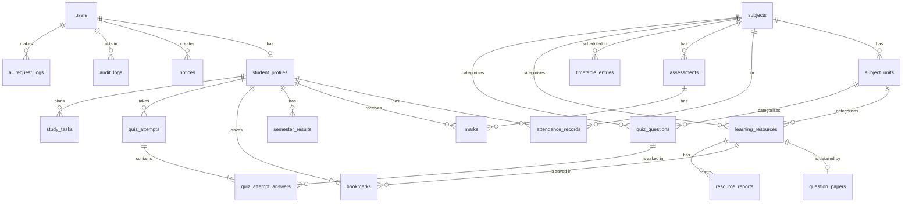

# 08. Database Design

> Status: Draft v0.1 · Owner: Laxman Sirvi · Last updated: 2026-10-10

The Flyway migration files in `src/main/resources/db/migration` MUST match this document. If they differ, fix one of them in the same change.

## 1. Systems of record

| Data | Authoritative system |
| --- | --- |
| Accounts, academic records, metadata, quiz data, logs | Supabase PostgreSQL |
| PDF files | Supabase Storage (private bucket). The database holds the path and metadata, never the bytes. |
| Sessions | Application memory (first release) |
| Secrets | Heroku config vars |
| AI prompts and responses | Not stored anywhere |

## 2. Conventions

- Schema `public`. Table and column names in `snake_case`, tables plural.
- Primary keys: `id BIGINT GENERATED ALWAYS AS IDENTITY`, unless stated.
- Timestamps: `TIMESTAMPTZ`, stored in UTC. `created_at` defaults to `now()`.
- Enumerated values: `VARCHAR` with a `CHECK` constraint, mapped to Java enums by name.
- Marks, percentages and grade points: `NUMERIC`, never floating point.
- Every foreign key column is indexed.
- Row Level Security is enabled on every table, with no policies (see [04-TRD.md](04-TRD.md) TR-DB-7).
- Deleting is rare. Records that are referenced are deactivated, hidden or retired instead.

## 3. Entity-relationship diagram

## 4. Data dictionary

### 4.1 `users`

Login identity for both roles.

| Column | Type | Constraints | Notes |
| --- | --- | --- | --- |
| id | BIGINT | PK | |
| username | VARCHAR(50) | NOT NULL, UNIQUE | Stored lowercase. A student's roll number. |
| password_hash | VARCHAR(100) | NOT NULL | BCrypt hash. |
| role | VARCHAR(20) | NOT NULL, CHECK in (`STUDENT`, `ADMIN`) | |
| display_name | VARCHAR(120) | NOT NULL | |
| active | BOOLEAN | NOT NULL, default true | |
| must_change_password | BOOLEAN | NOT NULL, default true | |
| failed_login_count | SMALLINT | NOT NULL, default 0 | |
| locked_until | TIMESTAMPTZ | NULL | |
| last_login_at | TIMESTAMPTZ | NULL | |
| created_at, updated_at | TIMESTAMPTZ | NOT NULL | |

### 4.2 `student_profiles`

| Column | Type | Constraints | Notes |
| --- | --- | --- | --- |
| id | BIGINT | PK | The "student ID" used by other tables. |
| user_id | BIGINT | NOT NULL, UNIQUE, FK → users | |
| roll_no | VARCHAR(20) | NOT NULL, UNIQUE | Stored uppercase. |
| full_name | VARCHAR(120) | NOT NULL | |
| branch | VARCHAR(20) | NOT NULL | For example `CSE`. |
| current_semester | SMALLINT | NOT NULL, CHECK 1 to 8 | |
| section | VARCHAR(5) | NOT NULL | |
| admission_year | SMALLINT | NOT NULL, CHECK 2000 to 2100 | |
| email | VARCHAR(254) | NULL | |
| phone | VARCHAR(20) | NULL | |
| created_at, updated_at | TIMESTAMPTZ | NOT NULL | |

Index: (`branch`, `current_semester`, `section`).

### 4.3 `subjects`

| Column | Type | Constraints | Notes |
| --- | --- | --- | --- |
| id | BIGINT | PK | |
| code | VARCHAR(20) | NOT NULL, UNIQUE | For example `CS301`. |
| name | VARCHAR(150) | NOT NULL | |
| branch | VARCHAR(20) | NOT NULL | |
| semester | SMALLINT | NOT NULL, CHECK 1 to 8 | |
| credits | SMALLINT | NOT NULL, CHECK 0 to 10 | |
| active | BOOLEAN | NOT NULL, default true | |

Index: (`branch`, `semester`).

### 4.4 `subject_units`

| Column | Type | Constraints |
| --- | --- | --- |
| id | BIGINT | PK |
| subject_id | BIGINT | NOT NULL, FK → subjects |
| unit_no | SMALLINT | NOT NULL, CHECK 1 to 20 |
| title | VARCHAR(200) | NOT NULL |

Unique: (`subject_id`, `unit_no`).

### 4.5 `attendance_records`

One row per student per class held.

| Column | Type | Constraints | Notes |
| --- | --- | --- | --- |
| id | BIGINT | PK | |
| student_id | BIGINT | NOT NULL, FK → student_profiles | |
| subject_id | BIGINT | NOT NULL, FK → subjects | |
| class_date | DATE | NOT NULL | Not in the future (checked in Java). |
| period_no | SMALLINT | NOT NULL, default 1, CHECK 1 to 12 | |
| status | VARCHAR(10) | NOT NULL, CHECK in (`PRESENT`, `ABSENT`) | |
| marked_by | BIGINT | NOT NULL, FK → users | |
| created_at, updated_at | TIMESTAMPTZ | NOT NULL | |

Unique: (`student_id`, `subject_id`, `class_date`, `period_no`). Index: (`subject_id`, `class_date`).

### 4.6 `assessments`

| Column | Type | Constraints | Notes |
| --- | --- | --- | --- |
| id | BIGINT | PK | |
| subject_id | BIGINT | NOT NULL, FK → subjects | |
| name | VARCHAR(100) | NOT NULL | For example "Internal 1". |
| assessment_type | VARCHAR(20) | NOT NULL, CHECK in (`INTERNAL`, `ASSIGNMENT`, `LAB`, `SEMESTER_EXAM`) | |
| max_marks | NUMERIC(5,2) | NOT NULL, CHECK > 0 | |
| held_on | DATE | NULL | |
| academic_year | VARCHAR(9) | NOT NULL | For example `2026-27`. |
| published | BOOLEAN | NOT NULL, default false | Students see marks only when true. |
| created_at | TIMESTAMPTZ | NOT NULL | |

Unique: (`subject_id`, `name`, `academic_year`).

### 4.7 `marks`

| Column | Type | Constraints | Notes |
| --- | --- | --- | --- |
| id | BIGINT | PK | |
| student_id | BIGINT | NOT NULL, FK → student_profiles | |
| assessment_id | BIGINT | NOT NULL, FK → assessments | The subject is reached through the assessment. |
| marks_obtained | NUMERIC(5,2) | NULL, CHECK >= 0 | NULL when absent. Not above `max_marks` (checked in Java). |
| absent | BOOLEAN | NOT NULL, default false | |
| entered_by | BIGINT | NOT NULL, FK → users | |
| updated_at | TIMESTAMPTZ | NOT NULL | |

Unique: (`student_id`, `assessment_id`). Check: `absent = true` or `marks_obtained IS NOT NULL`.

### 4.8 `semester_results`

| Column | Type | Constraints | Notes |
| --- | --- | --- | --- |
| id | BIGINT | PK | |
| student_id | BIGINT | NOT NULL, FK → student_profiles | |
| semester | SMALLINT | NOT NULL, CHECK 1 to 8 | |
| sgpa | NUMERIC(4,2) | NOT NULL, CHECK 0 to 10 | Official value entered by an admin. |
| credits_earned | SMALLINT | NOT NULL, CHECK >= 0 | |
| result_status | VARCHAR(10) | NOT NULL, CHECK in (`PASS`, `FAIL`, `WITHHELD`) | |
| published_at | TIMESTAMPTZ | NULL | Visible to the student when set. |
| updated_at | TIMESTAMPTZ | NOT NULL | |

Unique: (`student_id`, `semester`).

**CGPA is not stored.** `ResultService` calculates it from published rows as Σ(sgpa × credits_earned) ÷ Σ(credits_earned), rounded to two decimals. This rule is `TBD` until OQ-3 is answered.

### 4.9 `timetable_entries`

| Column | Type | Constraints | Notes |
| --- | --- | --- | --- |
| id | BIGINT | PK | |
| branch | VARCHAR(20) | NOT NULL | |
| semester | SMALLINT | NOT NULL, CHECK 1 to 8 | |
| section | VARCHAR(5) | NOT NULL | |
| day_of_week | SMALLINT | NOT NULL, CHECK 1 to 7 | 1 is Monday. |
| start_time | TIME | NOT NULL | |
| end_time | TIME | NOT NULL, CHECK > start_time | |
| subject_id | BIGINT | NOT NULL, FK → subjects | |
| room | VARCHAR(30) | NULL | |
| faculty_name | VARCHAR(120) | NULL | |

Index: (`branch`, `semester`, `section`, `day_of_week`). Overlaps within a section are rejected in Java.

### 4.10 `notices`

| Column | Type | Constraints | Notes |
| --- | --- | --- | --- |
| id | BIGINT | PK | |
| title | VARCHAR(200) | NOT NULL | |
| body | TEXT | NOT NULL | Plain text, max 5,000 characters (checked in Java). |
| category | VARCHAR(20) | NOT NULL, CHECK in (`GENERAL`, `EXAM`, `ASSIGNMENT`, `EVENT`) | |
| target_branch | VARCHAR(20) | NULL | NULL means all branches. |
| target_semester | SMALLINT | NULL, CHECK 1 to 8 | NULL means all semesters. |
| due_date | DATE | NULL | Makes the notice a deadline. |
| status | VARCHAR(10) | NOT NULL, CHECK in (`DRAFT`, `PUBLISHED`) | |
| published_at | TIMESTAMPTZ | NULL | |
| created_by | BIGINT | NOT NULL, FK → users | |
| created_at, updated_at | TIMESTAMPTZ | NOT NULL | |

Index: (`status`, `published_at` DESC).

### 4.11 `learning_resources`

| Column | Type | Constraints | Notes |
| --- | --- | --- | --- |
| id | BIGINT | PK | |
| title | VARCHAR(200) | NOT NULL | |
| description | VARCHAR(1000) | NULL | |
| subject_id | BIGINT | NOT NULL, FK → subjects | |
| unit_id | BIGINT | NULL, FK → subject_units | NULL for whole-subject material. |
| resource_type | VARCHAR(30) | NOT NULL, CHECK in (`NOTES`, `SYLLABUS`, `LAB_MANUAL`, `QUESTION_PAPER`, `MODEL_PAPER`, `IMPORTANT_QUESTIONS`) | |
| storage_path | VARCHAR(300) | NOT NULL, UNIQUE | Generated by the server. |
| original_file_name | VARCHAR(255) | NOT NULL | Display only. |
| mime_type | VARCHAR(100) | NOT NULL | `application/pdf` in the first release. |
| file_size_bytes | BIGINT | NOT NULL, CHECK > 0 | |
| checksum_sha256 | CHAR(64) | NOT NULL | |
| version | SMALLINT | NOT NULL, default 1 | |
| status | VARCHAR(10) | NOT NULL, CHECK in (`PUBLISHED`, `HIDDEN`) | |
| uploaded_by | BIGINT | NOT NULL, FK → users | |
| created_at, updated_at | TIMESTAMPTZ | NOT NULL | |

Index: (`subject_id`, `unit_id`, `resource_type`), (`status`, `created_at` DESC). Search in the first release uses case-insensitive matching on `title` and `description`.

### 4.12 `question_papers`

Extra details for resources of type `QUESTION_PAPER` or `MODEL_PAPER`.

| Column | Type | Constraints |
| --- | --- | --- |
| resource_id | BIGINT | PK, FK → learning_resources ON DELETE CASCADE |
| exam_year | SMALLINT | NOT NULL, CHECK 2000 to 2100 |
| exam_type | VARCHAR(20) | NOT NULL, CHECK in (`INTERNAL`, `SEMESTER`, `SUPPLEMENTARY`, `MODEL`) |
| max_marks | SMALLINT | NULL, CHECK > 0 |

Index: (`exam_year`).

### 4.13 `bookmarks`

| Column | Type | Constraints |
| --- | --- | --- |
| student_id | BIGINT | NOT NULL, FK → student_profiles |
| resource_id | BIGINT | NOT NULL, FK → learning_resources ON DELETE CASCADE |
| created_at | TIMESTAMPTZ | NOT NULL |

Primary key: (`student_id`, `resource_id`).

### 4.14 `quiz_questions`

| Column | Type | Constraints | Notes |
| --- | --- | --- | --- |
| id | BIGINT | PK | |
| subject_id | BIGINT | NOT NULL, FK → subjects | |
| unit_id | BIGINT | NOT NULL, FK → subject_units | |
| question_text | VARCHAR(1000) | NOT NULL | |
| option_a, option_b, option_c, option_d | VARCHAR(300) | NOT NULL | |
| correct_option | CHAR(1) | NOT NULL, CHECK in (`A`, `B`, `C`, `D`) | Never sent to a student before submission. |
| explanation | VARCHAR(2000) | NOT NULL | |
| difficulty | VARCHAR(10) | NOT NULL, CHECK in (`EASY`, `MEDIUM`, `HARD`) | |
| source | VARCHAR(20) | NOT NULL, CHECK in (`ADMIN`, `AI_GENERATED`) | |
| status | VARCHAR(10) | NOT NULL, CHECK in (`DRAFT`, `PUBLISHED`, `RETIRED`) | |
| created_by | BIGINT | NOT NULL, FK → users | |
| created_at, updated_at | TIMESTAMPTZ | NOT NULL | |

Index: (`subject_id`, `unit_id`, `status`).

### 4.15 `quiz_attempts`

| Column | Type | Constraints | Notes |
| --- | --- | --- | --- |
| id | BIGINT | PK | |
| student_id | BIGINT | NOT NULL, FK → student_profiles | |
| subject_id | BIGINT | NOT NULL, FK → subjects | |
| unit_id | BIGINT | NOT NULL, FK → subject_units | |
| question_count | SMALLINT | NOT NULL, CHECK 1 to 20 | |
| started_at | TIMESTAMPTZ | NOT NULL | |
| expires_at | TIMESTAMPTZ | NOT NULL | `started_at` + 60 s × `question_count`. |
| submitted_at | TIMESTAMPTZ | NULL | |
| status | VARCHAR(15) | NOT NULL, CHECK in (`IN_PROGRESS`, `SUBMITTED`, `EXPIRED`) | |
| score | SMALLINT | NULL, CHECK >= 0 | Number correct. |

Index: (`student_id`, `started_at` DESC).

### 4.16 `quiz_attempt_answers`

The questions served in an attempt and the student's answers.

| Column | Type | Constraints |
| --- | --- | --- |
| id | BIGINT | PK |
| attempt_id | BIGINT | NOT NULL, FK → quiz_attempts ON DELETE CASCADE |
| question_id | BIGINT | NOT NULL, FK → quiz_questions |
| position | SMALLINT | NOT NULL |
| selected_option | CHAR(1) | NULL, CHECK in (`A`, `B`, `C`, `D`) |
| is_correct | BOOLEAN | NULL until submitted |

Unique: (`attempt_id`, `question_id`).

### 4.17 `audit_logs`

Append-only record of sensitive changes.

| Column | Type | Constraints | Notes |
| --- | --- | --- | --- |
| id | BIGINT | PK | |
| actor_user_id | BIGINT | NOT NULL, FK → users | |
| action | VARCHAR(50) | NOT NULL | For example `MARKS_UPDATED`, `ATTENDANCE_CORRECTED`, `PASSWORD_RESET`, `ACCOUNT_DEACTIVATED`, `RESULT_UPDATED`. |
| entity_type | VARCHAR(50) | NOT NULL | |
| entity_id | VARCHAR(50) | NOT NULL | |
| old_value | JSONB | NULL | Never contains passwords or hashes. |
| new_value | JSONB | NULL | |
| ip_address | VARCHAR(45) | NULL | |
| created_at | TIMESTAMPTZ | NOT NULL | |

Index: (`entity_type`, `entity_id`), (`created_at` DESC). The application has no code path that updates or deletes rows in this table.

### 4.18 `ai_request_logs`

Metadata for limits and cost. **No prompt or response text is stored.**

| Column | Type | Constraints |
| --- | --- | --- |
| id | BIGINT | PK |
| user_id | BIGINT | NOT NULL, FK → users |
| feature | VARCHAR(30) | NOT NULL, CHECK in (`EXPLAIN`, `SUMMARIZE`, `GENERATE_QUIZ`, `SUMMARIZE_RESOURCE`, `FLOWCHART`) |
| prompt_version | VARCHAR(30) | NOT NULL |
| input_chars | INTEGER | NOT NULL |
| output_chars | INTEGER | NULL |
| status | VARCHAR(15) | NOT NULL, CHECK in (`SUCCESS`, `FAILED`, `TIMEOUT`, `DECLINED`) |
| duration_ms | INTEGER | NULL |
| created_at | TIMESTAMPTZ | NOT NULL |

Index: (`user_id`, `created_at`). Only `SUCCESS` and `DECLINED` rows count toward the daily limit.

### 4.19 `study_tasks` (P1)

| Column | Type | Constraints |
| --- | --- | --- |
| id | BIGINT | PK |
| student_id | BIGINT | NOT NULL, FK → student_profiles |
| title | VARCHAR(200) | NOT NULL |
| notes | VARCHAR(1000) | NULL |
| subject_id | BIGINT | NULL, FK → subjects |
| due_date | DATE | NULL |
| status | VARCHAR(10) | NOT NULL, CHECK in (`PENDING`, `DONE`) |
| completed_at | TIMESTAMPTZ | NULL |
| created_at | TIMESTAMPTZ | NOT NULL |

Index: (`student_id`, `status`, `due_date`).

### 4.20 `resource_reports` (P1)

| Column | Type | Constraints |
| --- | --- | --- |
| id | BIGINT | PK |
| resource_id | BIGINT | NOT NULL, FK → learning_resources ON DELETE CASCADE |
| student_id | BIGINT | NOT NULL, FK → student_profiles |
| reason | VARCHAR(500) | NOT NULL |
| status | VARCHAR(10) | NOT NULL, CHECK in (`OPEN`, `RESOLVED`) |
| created_at | TIMESTAMPTZ | NOT NULL |

## 5. Validation: database and Java

| Rule | Database | Java |
| --- | --- | --- |
| Unique roll number, username, subject code | UNIQUE | Friendly conflict message |
| Value ranges (semester, SGPA, marks ≥ 0) | CHECK | Bean Validation |
| Marks not above the assessment maximum | | `MarksService` |
| No future attendance date | | `AttendanceService` |
| No overlapping timetable entries | | `TimetableService` |
| Enumerated values | CHECK | Java enums |
| References exist | FOREIGN KEY | Not-found errors |

The database is the last line of defence. Java gives the helpful message first.

## 6. Data ownership

| Data | Owner | Who may change it |
| --- | --- | --- |
| Profile, attendance, marks, results | The college | Admin only |
| Subjects, timetable, notices, resources, question bank | The college | Admin only |
| Bookmarks, study tasks | The student | That student only |
| Quiz attempts | The student | Created by the student; scored by the system; never edited |
| Audit and AI logs | The system | Nobody |

## 7. Retention

| Data | Retention |
| --- | --- |
| Academic records and content | Life of the project |
| Quiz attempts | Life of the project |
| `ai_request_logs` | 90 days; older rows may be deleted by a scheduled job (P1) |
| `audit_logs` | Life of the project |
| Deactivated accounts | Kept; never hard-deleted by the application |

All data is synthetic, so no legal retention period applies. If real data were ever introduced, this section must be rewritten first.

## 8. Migration strategy

Flyway, versioned SQL files, forward-only. See [ADR 0006](decisions/0006-flyway-database-migrations.md).

| Version | File | Contents | Milestone |
| --- | --- | --- | --- |
| V1 | `V1__core.sql` | users, student_profiles, subjects, subject_units | M1 |
| V2 | `V2__academic.sql` | attendance_records, assessments, marks, semester_results, timetable_entries, notices, audit_logs | M2 |
| V3 | `V3__resources.sql` | learning_resources, question_papers, bookmarks | M3 |
| V4 | `V4__quiz.sql` | quiz_questions, quiz_attempts, quiz_attempt_answers | M4 |
| V5 | `V5__ai.sql` | ai_request_logs | M5 |
| V6 | `V6__planner.sql` | study_tasks, resource_reports | P1 |

Rules:

1. A migration that has been applied anywhere is never edited. A mistake is fixed with a new migration.
2. Every migration enables Row Level Security on the tables it creates.
3. Migrations contain structure only, never demo data.
4. A migration that drops or rewrites data needs the owner's approval before it is written.

## 9. Seed data

- A Java `DevDataSeeder`, active only in the `dev` profile, creates synthetic students, subjects, units, attendance, marks, notices and questions.
- Names and roll numbers are obviously fictional. No real person's data is used.
- Seeded account passwords come from `DEV_SEED_PASSWORD`. No password is written in the repository.
- The first administrator is created at startup from `ADMIN_BOOTSTRAP_USERNAME` and `ADMIN_BOOTSTRAP_PASSWORD` when no admin exists, with `must_change_password = true`.
- Demo data for the hosted application is loaded by running the seeder once with an explicit flag, with the owner's approval.

## 10. Backup and recovery

- Supabase's managed backups are the primary backup. Their frequency and retention depend on the plan and MUST be checked before the demo (OQ-7).
- Before any risky migration and before the demo, take a manual dump with `pg_dump` and keep it outside the repository.
- Files in storage are not covered by database backups. Keep the original demo PDFs in a private folder so they can be re-uploaded.
- Recovery steps are in [19-operations-runbook.md](19-operations-runbook.md).
